# KAL/S

Kerbal Avionics Language/Shuttle is a Space Shuttle flight software for Kerbal Space Program.

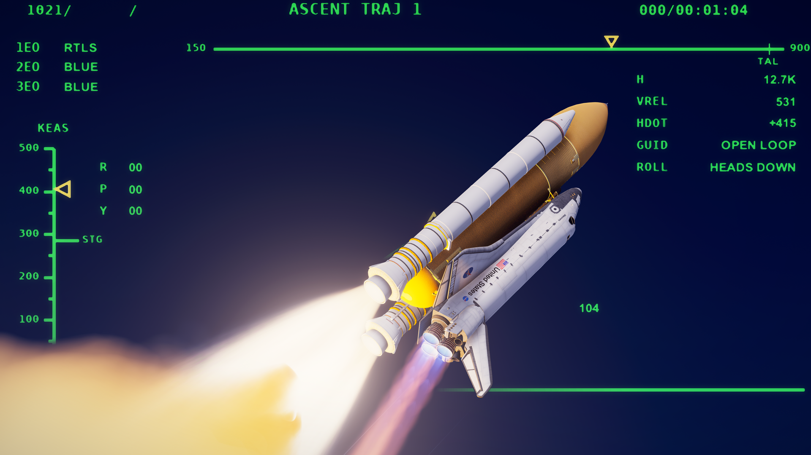

KAL/S flies a complete Shuttle mission on its own. It counts down, climbs to orbit, burns the OMS engines, deorbits, and flies entry, TAEM, approach and landing, and rollout to wheels stop. It also flies every abort on the way up, from a return to launch site to a contingency glide after two or three engine failures. You only start `ops1q` on the pad; it runs the rest. You watch the pages and take over by stick whenever you want to. A failure system can break the orbiter on a schedule or at random.

KAL/S is a set of kOS programs and libraries, a C# addon to kOS that runs the heavy arithmetic as compiled code, and part patches for the orbiter. It flies the SOCK (Shuttle Orbiter Construction Kit) orbiter in Quarter-Scale RSS Sol. Version 1.0.

Everything you need is in this file. The longer sections are collapsed: click a title to open it. The acronyms are explained in the Glossary under Reference.

- [What it flies](#what-it-flies)
- [Requirements](#requirements)
- [Install](#install)
- [Flying a mission](#flying-a-mission) (first flight, ascent, aborts, orbit, deorbit, the arm, entry, TAEM, landing)
- [When things go wrong](#when-things-go-wrong) (failures and SIMSUP, troubleshooting)
- [Reference](#reference) (displays, settings, glossary, Holo HUD, limitations)
- [Credits](#credits)
- [Licence](#licence)

## What it flies

| Phase | Program | Starts |
|---|---|---|
| Pad, countdown, ascent, MECO, OMS-2 plan | `ops1q` | By hand on the pad |
| Orbit: burns, deorbit planning, attitude, orbit pages, OMS / RCS status, the Canadarm | `ops2q` | OPS 2 PRO on the lower `ops1q` display |
| Entry, TAEM, approach and landing, rollout | `ops3q` | ENT on the OPS3 item of `ops2q`'s OMS/RCS page |
| Aborts after ET separation (TAL, RTLS, contingency, split-S) | `ops6q` | By `ops1q`, automatically |

Aborts that end in orbit (ATO) or after one orbit (AOA) go through `ops2q`, not `ops6q`: `ops1q` puts an OPS2 button on its lower display in place of HUD CAM (press it within 3 minutes, or type `RUN ops2q.`), and `ops2q` opens its ATO / AOA TGT page, which asks whether to fly an ATO or AOA before OMS-1; an AOA then enters with `ops3q`.

## Requirements

KAL/S runs on KSP 1.12.5 with kOS 1.6.0.1 (the version it is built against). Only tested on Windows, and Python 3 is required for the installer (get it from python.org and tick "Add python.exe to PATH" when you install it; `INSTALL.bat` says so if Python is missing). The installer checks the required mods below and warns about any that is missing. It does not check the optional ones, and it does not check KSCSwitcher (yours to install for the SHIFTED Cape).

Optional: Ferram Aerospace Research (FAR 0.16.1.2 is what KAL/S is flown with). KAL/S flies under stock aerodynamics or under FAR with the same guidance. There is no separate FAR package: install FAR or not, and run the same `INSTALL.bat`. The part patches follow whatever is installed when KSP starts, and the installer says so when it finds FAR.

<b>The mod list, versions tested and where to get them</b>

Versions are read from each mod's own version file in the install KAL/S is flown in (Principia's is the file version of its plugin adapter, Modular Launch Pads' the newest entry of its changelog). The installer does not check versions; it checks that each mod is there. Where the last column says CKAN, the mod is listed in CKAN, the KSP mod manager, under that name.

| Mod | Tested with | Used for | Where to get it |
|---|---|---|---|
| kOS | 1.6.0.1 | Runs the programs | [KOS releases](https://github.com/KSP-KOS/KOS/releases) |
| kOS for All! | | Puts the kOS core in the orbiter's forward fuselage | CKAN: `kOSforAll` |
| ModuleManager | 4.2.3 | Applies the patches | [ModuleManager forum thread](https://forum.kerbalspaceprogram.com/topic/50533-18x-112x-module-manager-423-july-03th-2023-fireworks-season) |
| Principia | 2026.10.10.280 | N-body gravity (not on CKAN: install by hand) | [Principia releases](https://github.com/mockingbirdnest/Principia/releases) |
| Kopernicus | 1.12.1.247 | Loads the planet pack | [Kopernicus releases](https://github.com/Kopernicus/Kopernicus/releases) |
| Sol (planet pack, Quarter-Scale RSS Sol option) | | The quarter-scale Earth | CKAN: `Sol-Core` |
| B9PartSwitch | 2.18.0 | Used by the orbiter's parts | [B9PartSwitch releases](https://github.com/blowfishpro/B9PartSwitch/releases) |
| SOCK (Benjee10 Shuttle Orbiter Construction Kit) | | The orbiter's parts | CKAN: `ShuttleOrbiterConstructionKit` |
| Benjee10 shared assets | 0.3.0 | The orbiter's parts | [Shared assets releases](https://github.com/benjee10/Benjee10_sharedAssets/releases) |
| SPOCK | | The drag chute | [SPOCK on GitHub](https://github.com/rogerwang86/SPOCK); also on CKAN where it is listed |
| Rocket Motor Menagerie | | The SSMEs (RM-25-69 Cotopaxi) | CKAN: `RocketMotorMenagerie` |
| Conformal Decals | 0.4.2 | The orbiter's flags and lettering | [Conformal Decals](https://git.offworld.city/drewcassidy/KSP-Conformal-Decals/releases/latest) |
| Kerbal Konstructs | 1.12.3 | Runways and sites | [Kerbal Konstructs releases](https://github.com/KSP-RO/Kerbal-Konstructs/releases) |
| Kerbin Side Remastered | 1.0.1 | The landing runways KALS_Sites places | [SpaceDock](https://spacedock.info/mod/1823/Kerbin%20Side%20Remastered) |
| Tundra Space Center | 2.0.2 | Pad 39B | [KSP forum thread](https://forum.kerbalspaceprogram.com/index.php?/topic/174368-143-tundras-space-center) |
| Katniss Cape Canaveral | | The KSC launch site | [Katniss Cape Canaveral](https://github.com/Katniss218/KatnisssCapeCanaveral) |
| PhotonCorp | | RSRB-4 boosters (launch craft) | [Photon Corp forum thread](https://forum.kerbalspaceprogram.com/topic/195598-wip-photon-corp-stockalike-orbital-atk-mod) |
| ORANGES | | The external tank (launch craft) | [ORANGES](https://github.com/EStreetRockets/ORANGES) |
| Modular Launch Pads | 2.9.1 | The pad (launch craft) | CKAN: `ModularLaunchPads` |
| htRobotics (comes with SOCK) | 1.0.1 | The Canadarm | [htRobotics releases](https://github.com/benjee10/htRobotics/releases) |
| Breaking Ground DLC | | The arm's servos | [Steam store page](https://store.steampowered.com/app/982970) |
| Holo HUD 1.0.0 (comes with KAL/S) | | The HUD's scripts and the kOS StockCamera addon 0.3.1 that HUD CAM needs: they are in the KAL/S package (`HoloHUD` folder) and `INSTALL.bat` installs them. Holo HUD is also its own release for any aircraft | [Holo HUD on SpaceDock](https://spacedock.info/mod/4867/Holo%20HUD) |
| KSCSwitcher (only for the SHIFTED Cape) | 2.2.0 | Moves the Cape | [KSCSwitcher releases](https://github.com/KSP-RO/KSCSwitcher/releases) |
| Ferram Aerospace Research (optional) | 0.16.1.2 | FAR aerodynamics | [FAR releases](https://github.com/KSPModStewards/Ferram-Aerospace-Research/releases) |
| Firefly (optional) | 1.0.6.0 | One continuous re-entry plasma envelope (SOCK RealAero adds it when installed and does nothing without it) | [Firefly releases](https://github.com/M1rageDev/Firefly/releases/latest) |
| Waterfall (optional) | 0.11.0 | Engine plumes (cosmetic) | [Waterfall](https://github.com/KSPModStewards/Waterfall) |

Trajectories is not required.

## Install

| Step | Do this | Notes |
|---|---|---|
| 1 | Close KSP. Install the mods above (Holo HUD is not one of them: it comes with KAL/S) | The KAL/S package carries Holo HUD 1.0.0 (the `HoloHUD` folder). `INSTALL.bat` installs it first, with the HUD scripts and the kOS StockCamera addon; you do not install it separately |
| 2 | Select Quarter-Scale Sol: open `GameData\Sol-Configs\Sol-Configuration.cfg` (inside the KSP folder) in a text editor, find the line `SystemScale = Quarter // Real, Quarter, Stock`, make sure the value before the `//` is `Quarter`, and save | `SystemScale` is the setting: the other values are `Real` and `Stock`, and KAL/S flies only Quarter. Change only that value, and leave the lines under "DO NOT TOUCH ANY VALUES BELOW THIS LINE" alone |
| 3 | Download the package zip from the [KAL/S releases on GitHub](https://github.com/Moka20090/KALS/releases) | Right-click it, Properties, tick Unblock, OK, before unpacking. Otherwise Windows asks "The publisher could not be verified" when `INSTALL.bat` runs: click Run (on the blue "Windows protected your computer" pop-up, More info, then Run anyway) |
| 4 | With KSP closed, run `INSTALL.bat` | See the box below |
| 5 | In KSP's Difficulty Options, under kOS, turn on "Start on the archive" | Or type `SWITCH TO 0.` in each new terminal |
| 6 | Restart KSP | The installer has installed the HUD fonts for your Windows user (no administrator needed; `--no-fonts` skips it). Without them the HUD still works, in Arial |
| 7 | With the orbiter loaded on its pad (Your first flight, step 1, shows how to open its kOS terminal), type `RUN kals_test.` once in that terminal | The terminal shows `KAL/S OK`, or `KAL/S NOT READY` with one FIX line for each thing to fix. The full check (kOS version, `ADDONS:KALS`, the addon's suffixes, FAR and a CAPE line saying AS PUBLISHED or MOVED) is written to `logs/kals_test.txt`. KSP.log carries a `[KalsCoproc]` line at start-up |

Run `INSTALL.bat` again after a kOS update or a change of screen size. To remove KAL/S, see Uninstall below.

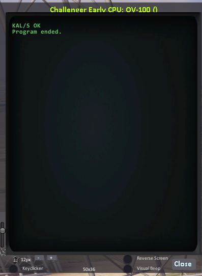

<b>What INSTALL.bat does, its questions and its switches</b>

| It does | Detail |
|---|---|
| Finds your KSP | Lists the KSP folders it finds and asks which one (`--ksp "<folder>"` answers it) |
| Checks | The mods above are there; it tells you which KAL/S release is installed now |
| Backs up | Every file it replaces goes to `KALS_backup\<date-time>\` |
| Copies | `Install\GameData` and `Install\Ships` into the folder, with a progress bar |
| Leaves alone | Your logs, your plans, your saved HUD eye, your `logging.txt` and any craft you changed |
| Sets up once | Raises kOS's instruction limit from 2000 to 10000 (kOS 1.6.0.1 only; the original `kOS.dll` is kept in `Ships\Script\kos_backup`) and writes `display.txt` from the screen size in KSP's `settings.cfg` |

| Question | Choices | Switch |
|---|---|---|
| Which craft to install | All (default), none, or a pick by number | `--craft all`, `--craft none`, `--craft "Columbia STS-1, Atlantis Late"` |
| Which Cape Canaveral | PUBLISHED (Katniss's Cape where Katniss put it, default) or SHIFTED (moved onto Sol's coast with a water fix) | `--cape off`, `--cape on` |

Other switches: `--dry` (say what it would do and change nothing), `--list`, `--yes` (answer yes to its confirmations), `--no-fonts`, `--no-setup` (skip the one-time setup), `--fov 40|60|70` (the HUD CAM field of view without asking: Holo HUD's installer gets it), `--uninstall`. The HUD's eye position is set in the game (`hud_cal.ks`); `--hud` is refused.

SHIFTED installs five small files of KAL/S's own (a terrain decal, its height map, a ModuleManager patch); Katniss's own files are never changed or copied. It needs Katniss Cape Canaveral, Kopernicus, Kerbal Konstructs and KSCSwitcher. An existing save loads with either answer; a vessel landed near the Cape can move (see Troubleshooting).

**Holo HUD and KAL/S know each other** `INSTALL.bat` installs the bundled Holo HUD 1.0.0 first. A newer Holo HUD already in your KSP folder is kept as it is (the bundled one never overwrites a newer one); an older or equal one is brought up to date. `INSTALL.bat --dry` shows which. Installing Holo HUD's own release over KAL/S, or KAL/S over Holo HUD, breaks neither.

**Uninstall** Double-click `UNINSTALL.bat`, beside `INSTALL.bat`. It asks which KSP folder (`--dry` says what it would do, `--yes` asks nothing), removes what `INSTALL.bat` installed, puts back what it replaced and sets the kOS instruction limit back to 2000. It removes only KAL/S: Holo HUD, the StockCamera addon and the HUD scripts stay, because Holo HUD is a package of its own. To remove Holo HUD too, run `HoloHUD\UNINSTALL.bat`; while KAL/S is still installed it warns that KAL/S's programs need Holo HUD and asks before going on. Files you changed since the install, and your logs, plans and saves, are never removed. The HUD fonts stay in your Windows fonts (Settings, Fonts removes them).

<b>What the package installs, and where</b>

| Folder in the package's `Install` folder | Goes to |
|---|---|
| `Ships/Script/` (programs, `lib/`, display backgrounds) | Your KSP folder's `Ships/Script/`, which is kOS's archive |
| `GameData/KALS_Coproc` | The C# addon, `KalsCoproc.dll` |
| `GameData/KALS_RealAscent` | Patches for ascent parts (SSME specific impulse, SRBs and their filament-wound cases, tank, payload, SRB separation) |
| `GameData/SOCK_RealAero` | Patches and `SockRealAero.dll` for the orbiter's aerodynamics, heating, gear, mass balance and drag chute |
| `GameData/KALS_Sites` | Kerbal Konstructs runways |
| `GameData/KALS_CW` | Caution and warning tones |
| `GameData/KALS_kOS` | Lowers the orbiter's kOS part power draw to a fifth, so the programs can run on the fuel cells |
| `GameData/KALS_BayModels` | The payload bay models (sills, MPM pedestals, latches, handrails, blankets, floodlights, the GAS beam and canister) |
| `GameData/KALS_CapeWater`, `GameData/ZZ_KALS_CapeShift` | Only with the SHIFTED Cape answer |
| `Ships/VAB` | The craft: the five Early, the five Late, Atlantis / Discovery / Endeavour 2000 and Columbia STS-1 (14) |
| `Fonts/` (beside the `Install` folder) | The HUD fonts the installer puts in your Windows user fonts |

## Flying a mission

A normal flight needs one `RUN`: `RUN ops1q.` on the pad, typed in the orbiter's kOS terminal (the full stop after the name ends a kOS command). The programs hand over to each other, and hand data to each other through files in `Ships/Script`. Every page carries buttons; each section below names the ones a crew needs.

<b>Your first flight: one whole mission in ten steps</b>

Each row is one thing you do; programs do the rest until the next row.

| Step | You | What happens |
|---|---|---|
| 1 | Install (see Install) and start KSP. In the VAB load one of the craft the installer put there (for example Atlantis Late) and launch it from its pad: LC-39B at KSC, or Vandenberg_SLC-6 at Vandenberg (the names in KSP's launch site list). | Right-click the orbiter's kOS core (kOS for All!) and open its terminal: you type there. |
| 2 | Type `RUN kals_test.` once in that terminal | The terminal should read `KAL/S OK` (see Install). |
| 3 | Type `RUN ops1q.` | A target box opens. Press ACCEPT with its defaults (KSC: 36.25 degrees, 160 km; Vandenberg: 98 degrees south, 160 km). |
| 4 | Nothing | The countdown runs to liftoff (see Ascent). You do not stage. |
| 5 | Watch ASCENT TRAJ pages | Stage 1 and stage 2 fly themselves to MECO and ET separation. The "!" button opens FAILURES, to break something on purpose. |
| 6 | After MECO press OPS 2 PRO (the button waits 3 minutes; after that type `RUN ops2q.`) | `ops1q` has written an OMS-2 plan; `ops2q` takes over with the vehicle as it is. |
| 7 | `ops2q` opens on MNVR EXEC: pick the OMS-2 plan in its BURN list, press ARM, then EXEC (see Orbit: MNVR EXEC) | The OMS-2 burn circularises the orbit. |
| 8 | Any time in orbit: DEORB TGT, pick the site, SOLVE, LOAD → MNVR; then ARM, EXEC | Deorbit burn. It unlocks OPS3. |
| 9 | Open the OMS/RCS page, move the cursor to the lit OPS3 item and press ENT (see Orbit: OMS/RCS), as soon as the deorbit burn is done | `ops3q` coasts to the entry interface (it warps and sets the entry attitude itself), then entry, TAEM, approach and landing, and rollout fly themselves. |
| 10 | Nothing, or fly it yourself: PITCH and ROLL/YAW each switch one axis to CSS (the stick), so you can take pitch, roll/yaw or both | Rollout to wheels stop; `ops3q` ends on the runway. |

Good to know:

- The acronyms (MECO, OMS, RTLS, TAL, ATO, AOA, OPS, PEG, HAC and the rest) are explained in the Glossary under Reference.
- The kOS terminal stays blank in flight; that is normal. Each program shows its messages in its own window, such as the MSG line in `ops2q`. `ops3q` and `ops6q` write theirs only to their logs.
- Logs are off by default (see Settings). The plans and hand-off files the programs pass to each other are always written.

<b>Ascent: ops1q, the target box and the countdown</b>

On the pad, type `RUN ops1q.` A box called OPS 1 LAUNCH TARGET opens before anything else happens.

| Section | What you set | What the lines under it say |
|---|---|---|
| MECO TARGET | APOAPSIS in km (default: the site's 160 km) | The height, flight path angle and velocity (VI, m/s) at main engine cutoff that apoapsis means. Orange: `APOAPSIS MUST BE OVER <n> KM`; `VI +<n> M/S OVER NOMINAL ...: MAY RUN DRY` when the external tank may run dry; at Vandenberg `NO FWC SRBS (STEEL CASES): MECO TARGET MAY NOT BE REACHED` (the polar launch needs the lighter filament-wound cases) |
| ORBIT PLANE | INCLINATION in degrees; LAUNCH NORTH or SOUTH | The launch azimuth and the stage 1 heading. The inclination must lie between the pad's latitude and 180 degrees minus it (`INCLINATION: <low> TO <high> DEG (PAD <latitude> N)`, with S for a southern pad) |
| OMS KEPT AFTER OMS-2 | ON-ORBIT DV in m/s: the OMS propellant you want left in orbit for your own burns, on top of the deorbit and the emergency reserve | The OMS ASSIST estimate (`OMS ASSIST EST. <n> T`) when the boosters' and tank's margin needs it, or `OMS: NOT MEASURED YET` until the OMS propellant has been read. Orange: `OMS SHORT <n> M/S` or `ET SHORT <n> M/S WITH OMS ASSIST`: the plan does not fit; press ACCEPT twice (the second press at least 1 s after the first) to launch anyway |
| TAL SITES (WEATHER) | One button per transatlantic abort site, GO or NO WX (orange): NO WX bans the site, and a banned site is not offered | "ALL NO WX: NO TAL" with every site banned. Vandenberg has no TAL site, so no weather section |

| Button | Does |
|---|---|
| ACCEPT | Starts the countdown. The summary line shows your choices, or "FIX THE ORANGE LINES." while a value is not valid |
| DEFAULTS | Restores the site's values and puts every TAL site back to GO. KSC: 36.25 degrees, 160 km (86.4 NM). Vandenberg (SLC-6): 98 degrees south, 160 km (86.4 NM) |
| CANCEL | Ends the program |

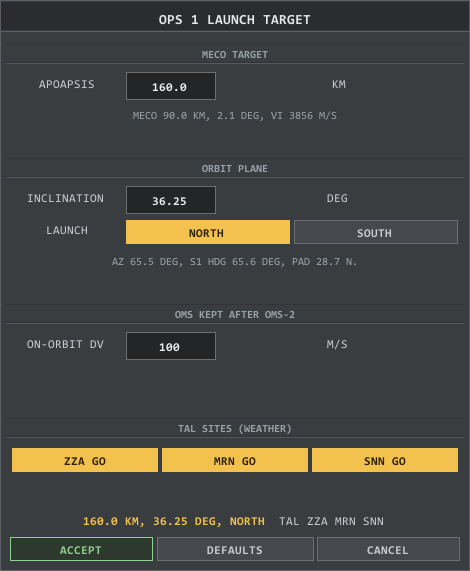

**The countdown** The GUID line of the page shows the count text (T-30 HOLD, then the seconds). For a launch without a countdown, type `SET ASC_CD TO FALSE.` before running; you then stage by hand.

| Time | What happens |
|---|---|
| T-30 s | The count starts and holds while the abort searches finish and the launch tower arms retract |
| T-10 s | The sparklers light |
| T-6.6 s | The three SSMEs start (engine 3, then 2 and 1, 0.12 s apart) and throttle up over 3.5 s |
| T-6.6 s to T-0 | RSLS (the redundant set launch sequencer) watches the engines. An SSME that fails, or is below 90 % of the strongest at T-3, stops the launch on the pad (`RSLS ABORT: SSME <n> ...`); the program ends 5 s later |
| T-0 | The boosters light and the orbiter lifts off |

You can fail an SSME on the pad with the "!" button's FAILURES window.

<b>Ascent: the pages, the buttons and what each reading means</b>

`ops1q` shows two windows on the left of the screen: the TRAJ window (a page with two rows of buttons above it) and, under it, the OMS/MPS window. Heights are in km (written with K) and speeds in m/s; the bar scales show m/s.

**Buttons above the TRAJ page**

| Button | Does |
|---|---|
| PITCH AUTO / CSS, ROLL/YAW AUTO / CSS | Switch each axis between the guidance (AUTO) and control stick steering (CSS: the stick out of its detent commands a turn rate, and back in the detent the orbiter holds the attitude it reached). The guidance keeps running and the page keeps showing its target. CSS works from liftoff through MECO and the hand-off |
| Mode [list] | The abort modes open now (RTLS, TAL, ATO); pick one |
| ABORT | Commits the abort picked in the Mode list (see "Ascent aborts") |
| TAL site [list] | The TAL sites open now, best first, each with a rank margin in m/s; the least-propellant site is picked until you pick another |
| ! | Opens the FAILURES window (see "Failures: the FAILURES window and its keys") |

**ASCENT TRAJ 1** is the stage 1 page, with the boosters burning. The pad shows it as LAUNCH TRAJ 1; after an abort it takes the abort's name, for example RTLS TRAJ 1.

| Field | What it shows | Range / values |
|---|---|---|
| KEAS scale (left) | Equivalent airspeed in knots, a pointer and STG, the airspeed at booster separation | 0 to 500 |
| Upper bar | Inertial velocity VI, with a triangle for the orbiter | 150 to 900 m/s |
| Plot | Height against relative velocity, the orbiter's symbol and a predicted point 15 s ahead | 0 to 24 km, 0 to 914 m/s |
| H, VREL, HDOT | Height, velocity relative to the air, climb rate | km, m/s, m/s |
| GUID | OPEN LOOP in stage 1 (READY and the count on the pad) | |
| ROLL | ROLL PGM, then HEADS DOWN | |
| THROT | Throttle | Percent |
| PC< | Appears with a pressure as the booster thrust tails off: the cue for booster separation | |
| R, P, Y | Attitude error to the guidance's target, with a direction letter (L or R, D or U) | Degrees; 00 on target, "---" when guidance is lost |

**ASCENT TRAJ 2** is the stage 2 page (the SSMEs alone).

| Field | What it shows | Range / values |
|---|---|---|
| Upper bar | Inertial velocity VI, with a triangle for the orbiter | 750 to 4000 m/s |
| Plot | Height against VI, with predicted points 15 and 30 s ahead | |
| Left scale | Delta HDOT: the climb rate against the nominal | Plus or minus 60 m/s |
| G scale | Acceleration | 1 to 3.5 g |
| TGO | Time to MECO | Minutes:seconds |
| GUID | CONV (the guidance has converged); UNCONV in yellow with the count of misses; FINE COUNT and MECO SET in the last seconds; "----" if guidance software failed; after cutoff MECO CUT, MECO LOW LVL, MECO ENG OUT or EMERGENCY SEP | |
| ROLL | ROLLING, HEADS UP | |
| VI, H | Inertial velocity, height | m/s, km |
| TGT H, TGT gamma | The MECO target height and flight path angle | km, degrees |
| HA, HP | Apoapsis and periapsis, after MECO | km |
| HDOT, R, P, Y, THROT | As on ASCENT TRAJ 1 | |
| PRPLT | The tank's propellant that can still be burned | Percent |
| TMECO | The predicted MECO time | |
| DROOP | The predicted low point of an altitude droop, yellow while the droop is flown | km |

**RTLS TRAJ 2** replaces ASCENT TRAJ 2 in an RTLS.

| Field | What it shows | Range / values |
|---|---|---|
| Upper bar | Delta-R, the range error, with marks CO, PD and PD3 | Minus 97 to plus 11 NM |
| Plot | The flyback, with predicted points 30 and 60 s ahead | |
| Left scale | Acceleration | 1 to 3.5 g |
| TGO | Time to go (PPA with a time during the fuel dissipation) | |
| GUID | Guidance state | |
| MODE | DISSIP, PPA, FLYBACK, PPD or 5 | |
| VREL, H, HDOT | As on ASCENT TRAJ 1 | |
| Alpha, beta | The nose's angle against the wind | Degrees |
| RNG | Range to the runway | km |
| THROT, PRPLT, TMECO | As on ASCENT TRAJ 2 | |

**The mode lines and the bar's marks** At the top left of every ascent page, 1EO, 2EO and 3EO each name what a failure of that depth would fly at the velocity you have now: PRESS (press on to MECO), ATO, TAL, RTLS, or in a contingency GREEN or BLUE. The mode flown after a failure is lit yellow; the lines of a depth already passed freeze in dark green. The bar's marks sit at the velocities where the modes open.

| Mark | Means |
|---|---|
| TAL, ATO, PRESS | The first-engine-out modes open from here |
| 2EO TAL, 2EO ATO, 2EO PRESS | The same after a second engine out |
| NEG RTN | Negative return: an RTLS is refused beyond it |
| CO | Cutoff |

**MESSAGES** The three rows under the page show the newest events: liftoff, booster separation, SSME failures, abort calls, throttle changes, OMS assist, MECO and ET separation. An SSME failure is red; abort and 2EO / 3EO calls are yellow. A warning takes a red line above them, which leaves room for two messages.

**OMS/MPS page** (the second window) has five columns, SSME L, C and R and SRB L and R, with a bar for each. The SSME bars run from 40 to 110 percent throttle. A booster's bar is its thrust as a share of its own peak, from 0 to 100 percent over the same height, and the number above it is that share.

| Item | What it shows |
|---|---|
| Each SSME | READY, ON (with its throttle), OUT in red, SHDN after MECO |
| Each booster | READY, BURN with its thrust, then SEP |
| ET LO2, ET LH2 | Tank levels, percent |
| OMS OX, OMS FU | The OMS tanks |
| FUEL CELL | ON or OFF |
| GIMBALS | FREE or LOCKED |
| 1EO / 2EO / 3EO lines | The same lines as the TRAJ page |

| Button | Does |
|---|---|
| HUD OFF / ON | Shows or hides the HUD |
| HUD CAM OFF / ON | Snaps the camera to the HUD's eye |
| ALT MODE RDR / BARO | Which height the HUD uses |

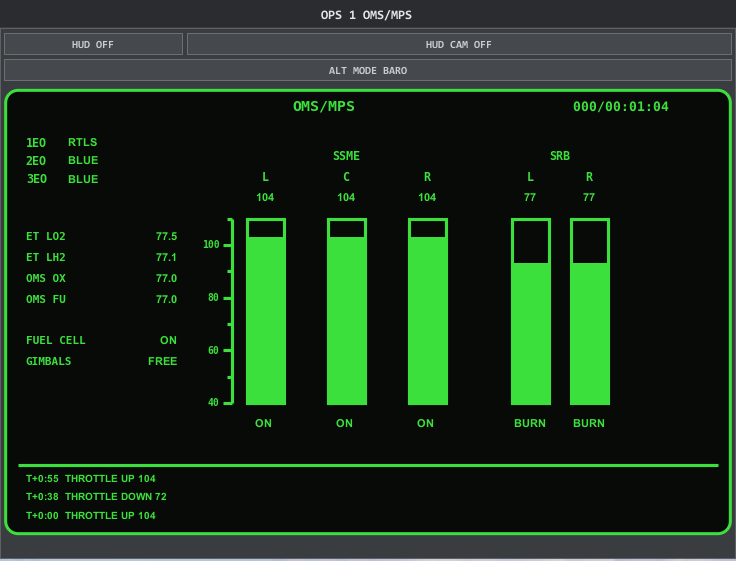

**MECO and the hand-off**

| Step | What happens |
|---|---|
| 1 | MECO comes at the guidance's cutoff. To cut early after booster separation, press action group 4 (key 4 in KSP's defaults): a manual MECO |
| 2 | The throttle comes down by itself to hold 3 g. If guidance has failed, a backup limiter cuts the throttle at 3 g instead |
| 3 | The tank separates. `ops1q` writes the OMS-2 plan and the OPS 2 PRO button appears, in place of HUD CAM on the OMS/MPS page |
| 4 | If you were flying in CSS, the hand-off waits up to 45 s for you to line up with the attitude it holds (within 3 degrees and 0.5 degrees a second) and posts a status line every 15 s. Action group 4 ends the wait at once |
| 5 | After an abort, `ops1q` hands over to `ops6q` itself. For an ATO or AOA it shows an OPS2 button in place of HUD CAM and waits 3 minutes for your press; after that type `RUN ops2q.` |

Launch sites: KSC (RTLS to the Shuttle Landing Facility) and SLC-6 (RTLS to Vandenberg). `ops1q` picks the one nearest the pad.

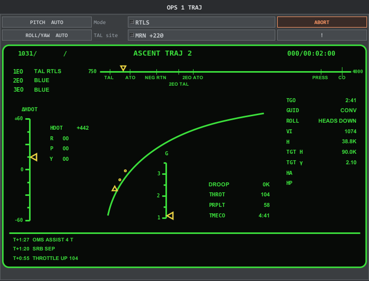

<b>Ascent aborts: choosing a mode, and what ops6q flies</b>

**Choosing an abort** On the TRAJ page pick a mode in the Mode list (only the modes open at your velocity are listed), pick a site in the TAL site list if you want a TAL (ZZA Zaragoza, MRN Moron or SNN Shannon, best first), and press ABORT. A first engine failure with no abort selected picks the best open mode by itself.

| Rule | What the messages say |
|---|---|
| ABORT works only after liftoff and with a mode picked | "ABORT ...: NOT BEFORE LIFTOFF", "ABORT: SELECT A MODE FIRST" |
| A mode that is not open | "NOT AVAILABLE" or "TOO LATE" |
| One abort per flight. Exceptions: a TAL can replace an ATO; after an automatic pick you can switch between ATO and TAL, or to an RTLS while it is still open | "ALREADY SELECTED" when you press the same mode again |
| A TAL to another site | Pick the site and press ABORT again (the line reads `TAL SITE <name> (WAS <name>)` and the velocity, or `TAL SITE <name>: TOO LATE`) |
| In stage 1 an abort waits for the guidance to start at booster separation | |
| An RTLS is refused once the roll to heads-up has started (the NEG RTN mark on the bar shows where) | "ABORT RTLS FAIL: PAST NEGATIVE RETURN" |
| An ATO can be picked until its OMS plans are written (after tank separation); a TAL until the guidance's fine count | |
| A second and a third engine failure pick the mode by themselves (lines 2EO and 3EO of the page) | "2EO ABORT TAL ...", "3EO ATO ...", "2EO CONT MODE ..." in yellow |

**What `ops6q` flies** A crew does not start `ops6q`. After ET separation `ops1q` starts it in one of four modes and hands over the vehicle. It continues `ops1q`'s propellant dump while it starts, and then shows the pages and buttons of entry and landing (see "Entry", "TAEM" and "Approach, landing and rollout"; the buttons work the same). You do not stage: the next stage is the drag chute.

| Mode | Case | What the crew sees and does |
|---|---|---|
| TAL | Transatlantic abort landing, to Zaragoza, Moron or Shannon | An entry with no deorbit plan, aimed at the site's runway; ENTRY TRAJ comes up before the entry interface and switches by itself to the live panels once they are ready; then TAEM, approach and landing as after a normal entry |
| RTLS | Return to launch site: powered return, then a GRTLS glide | RTLS TRAJ 2 shows the return (DISSIP, PPA, FLYBACK, PPD); after MECO and ET separation the orbiter glides to the runway, with VERT SIT and HORIZ SIT |
| CONT | Contingency after two or three SSMEs fail in stage 2: GREEN glides to an emergency landing site on the North American east coast, in Bermuda or in Europe; BLUE ends in a bailout | The glide pages as the GRTLS |
| SPLITS | Split-S after two or three SSMEs fail in stage 1, while the boosters burn | The split-S turns the orbiter back toward the runway (the Shuttle Landing Facility or Vandenberg); the glide pages as the GRTLS, with no ENTRY TRAJ |

**GREEN and BLUE** In an RTLS, `ops6q` tests whether the glide reaches the runway. When it falls short, the VERT SIT title row shows GRTLS and BLUE buttons and a 30 s countdown (this differs from the real shuttle).

| Pick | Result |
|---|---|
| BLUE, or no pick in 30 s | A bailout flight |
| GRTLS | An attempt to reach the runway |

Every BLUE banks toward a line 5 km off the nearest coast and bails out over water. BAILOUT is live from the GRTLS through TAEM.

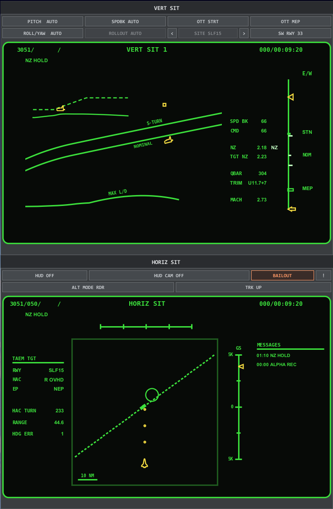

<b>Orbit: the ops2q window, its buttons and keys</b>

Press OPS 2 PRO on the lower `ops1q` display (or type `RUN ops2q.`). `ops2q` is one window: it plans burns, flies them, plans the deorbit, holds attitude, shows the orbit, reports OMS and RCS status and runs the Canadarm. Its pages use metric units. It ends when you press OPS3 on the OMS/RCS page (that runs `ops3q`) or with Ctrl+C (Ctrl+C does not hide the window; type `clearguis().` for that).

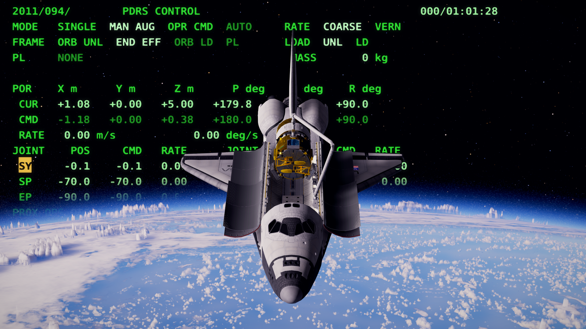

| Part of the window (top to bottom) | What it holds |
|---|---|
| Title bar | The name of the page on show |
| Page row | MNVR EXEC, DEORB, ORBIT / PTG, OMS/RCS and PDRS; the page on show is lit. The "!" button at the right end opens the FAILURES window |
| The page | A black screen of 20 text rows. Row 0 holds the page number and name on the left and the mission elapsed time (day/hours:minutes:seconds) on the right; a loaded burn adds its countdown to ignition below it. The MSG rows at the bottom show the last two messages, newest on top: refusals (`NOT ARMED`, `TIG TOO CLOSE`) and results (`CUTOFF: ...`) |
| Control grid | The buttons below the page |

| Page | Number on screen | How you reach it |
|---|---|---|
| MNVR EXEC | 2021/ | Page row |
| DEORB TGT | 2022/ | Page row |
| ATO / AOA TGT | 2025/ | Page row, in DEORB's place after an ascent abort to orbit |
| BRN PLN | 2023/ | BRN PLN button on MNVR EXEC and ORBIT / PTG, or PLAN FROM HERE and COPY on FPLN TREE |
| FPLN TREE | 2024/ | FPLN TREE button on MNVR EXEC |
| ORBIT / PTG | 2011/ | Page row |
| OMS/RCS | 2011/ | Page row |
| PDRS CONTROL | 2011/094/ | Page row |

**The cursor** is a black-on-amber box on one field at a time.

| Colour | Means |
|---|---|
| Green | Fixed text |
| Brighter green | A live value |
| Brightest | The choice that is selected |
| Dim | Unused or no data; pressing it puts `<name> NOT AVAILABLE` (or the reason) on the MSG rows |
| Yellow | Merits your attention |
| Red | A warning |

| Kind of field | How you change it |
|---|---|
| A number (DVX, DB ...) | Minus and plus change it by its step. STEP x10 and STEP /10 make the step ten times bigger or smaller (the step shows in the bottom right corner while the cursor is on a number). TYPE opens the keypad |
| A time (TIG) | Typed as digits, days then hours, minutes and seconds (DDDHHMMSS; leading zeros not needed) |
| A choice (several words on a row, one lit, for example GUID: PEG 4, PEG 7, PEG 8) | Plus and minus step through the words, left and right arrows move the cursor over them, ENT selects the word under the cursor |
| A word item with a list (the BURN source, the DEORB site, TRACK's body and target) | ENT opens a drop-down list. Up and down arrows move in it, ENT picks, left or right arrow or CANCEL closes it with no change |
| An action word (ARM, EXEC, SOLVE, SAVE, LOAD ...) | ENT presses it |

**The keypad** TYPE replaces the grid with 0 to 9, a minus sign, a decimal point, BKSP (deletes the last character), CANCEL and ENT; CUT OFF stays on the grid. The first character you type replaces the old value. ENT accepts it; `NOT A NUMBER` or `OUT OF RANGE <low>...<high>` says why a value is refused. A time field takes digits only. With the keypad open you can type on the keyboard: digits, the decimal point, the minus sign, the plus key (it removes a minus sign), Backspace, Enter or Space (ENT) and Esc (CANCEL). Every other key does nothing, and the mouse and camera stay free.

| Button of the grid | Does |
|---|---|
| Minus, plus | Change the field under the cursor |
| The four arrows | Move the cursor |
| ENT | Select or press the item under the cursor |
| TYPE | Open the keypad on a number or time field |
| CANCEL | Close the keypad or a list without a change; also stops an XFER in progress |
| STEP x10, STEP /10 | Change the step of a number |
| INPUT PAGE, INPUT RHC | Choose what drives the cursor (below) |
| CUT OFF | End a burn, or stop the sequence before ignition (see MNVR EXEC). On PDRS it splits into EE CAM and STOP |

| Input | How the grid is driven |
|---|---|
| INPUT PAGE (default) | You press the grid's buttons with the mouse, Space for ENT, and action group 4 (key 4 in KSP's defaults) for TYPE |
| INPUT RHC | The rotation hand controller (the stick) presses the grid for you: pitch forward or back is the up and down arrow, yaw is left and right, roll is minus and plus (in KSP's default keys W S A D Q E, which the grid then labels); Space still presses ENT. A held deflection repeats about every 0.4 s |

INPUT RHC greys out while something else owns the stick: the arm in MAN AUG, PROX OPS's STICK ORB, PROX OPS in CSS, or the orbit DAP in CSS. The MSG rows say which. Your choice comes back when the stick is free.

**On its own** `ops2q` starts the orbit DAP holding the attitude the orbiter had (AUTO, INRTL), reads the OMS and RCS tanks and engines every second or so, mirrors Principia's flight plans into FPLN TREE (read only) and keeps the caution and warning panel up to date.

<b>Orbit: MNVR EXEC, flying a burn</b>

MNVR EXEC holds one loaded burn and flies it. A burn gets in from three places: BRN PLN (LOAD), DEORB TGT or ATO / AOA TGT (LOAD to MNVR), or the BURN list on this page (the plan files `ops1q` wrote: OMS-1, OMS-2, the saved deorbit plan, and the burns of FPLN TREE planned from the live orbit).

| Row / item | What it shows or does |
|---|---|
| OMS | BOTH, L, R or RCS: which engines burn. RCS (a burn on the thrusters) is dim and not available. A failed engine dims itself and BOTH |
| TIG | Time of ignition, as mission elapsed time; you can type it before you arm. On the right the countdown to TIG: minus before, plus after |
| GUID | PEG 7, PEG 4 or PEG 8 (below). A loaded deorbit plan starts on PEG 4, a Principia or n-body burn on PEG 8, any other burn on PEG 7 |
| BURN | The loaded burn's name, with `(EDITED)` once you change its TIG or dV. With several plan files it is a list to pick from; empty it reads `- NONE (SELECT)` (or `- NONE (BRN PLN / DEORB)` when there is nothing to pick). WT is the orbiter's mass (kg). TYPE names the kind of burn (OMS-1, OMS-2, DEORB, CIRC, DV ...) |
| DV bar (rows 5 and 6) | A line from 0 to the burn's total dV with a pointer for what the orbiter has gained |
| DVX, DVY, DVZ | The planned dV in m/s in the local frame: X forward along the orbit, Z down toward Earth, Y sideways out of the orbit plane. Read only under PEG 4 and PEG 8 (the guidance's velocity to go) |
| BURN ATT | R, P, Y: the attitude the nose must take for the burn, in degrees (roll about the thrust line, pitch, yaw from the local frame). MNVR turns the orbiter to it at once and holds it (the orbit DAP, in INRTL) |
| ATT ERR | The angle between the OMS thrust line and the velocity to go |
| TV ROLL | The roll about the thrust line, degrees from heads-up at ignition; 180 (default) is heads down |
| PEG 4 targets (while GUID is PEG 4) | C1 and C2 (the line of radial against horizontal speed it flies to), HT (the target point's height, km) and THETA T (how far ahead of the burn the point is, degrees). A deorbit plan loads with these set. `NO SOLUTION` in red: they cannot be met |
| VGO block | TOT: the total velocity still to be gained (m/s). TBRN: the planned length (becomes TGO once the burn runs). VGX, VGY, VGZ: the velocity to go in the local frame. HA and HP with TGT (the orbit after the burn) and CUR (the orbit now), km |
| After the cutoff: RCS TRIM | The dV still left in body axes (X forward, Y right, Z down), for trimming by hand with the RCS |
| Bottom row | UNLD (takes the burn off the page; it stays in its plan file and the tree), ARM, EXEC, BRN PLN, FPLN TREE |

| GUID mode | What it flies | When it is offered |
|---|---|---|
| PEG 7 | The dV shown (the standard burn guidance) | Any burn |
| PEG 4 | The deorbit's guidance: it flies to a target point | Only when the burn's coast reaches the entry interface, and not with a sideways dV (DVY). Otherwise `PEG 4: DEORBIT ONLY, USE PEG 7 OR 8` |
| PEG 8 | A fictional mode: it flies the burn so that its coast meets the flight plan's next point. AIM T+ and MISS show where it aims and how far it would miss | Only for a Principia plan burn or a BRN PLN burn solved by SOLVE (the n-body solve) |

**Flying the burn**

| Step | You | The program |
|---|---|---|
| 1 | Load the burn. Check TIG, the dV and the GUID. Press ARM (it turns bright; ARM again disarms) | With TIG less than 5 minutes away, tells you how long the turn to the burn attitude will take. Changing TIG, the dV, GUID or the PEG 4 targets disarms it |
| 2 | Press EXEC | Refuses with a message if the burn is not armed, has no dV (`NO DV TO BURN`), ignition is too close (`TIG TOO CLOSE`: it needs 60 s, or the time the turn to the burn attitude needs if that is longer), both OMS engines are out, or the orbit DAP is not available |
| 3 | Nothing | Runs the sequence with the window up: time-warps to TIG minus 5 minutes (if TIG is further away); closes the payload bay doors (only for a deorbit burn or an AOA OMS-2: any other burn leaves them as they are); unlocks the OMS gimbals; puts the RCS on and the control point on the OMS; turns to the burn attitude (at the page's RATE, at least 2 degrees a second) and nulls the rate; warps to TIG minus 20 seconds and settles. At TIG it lights the engines, guides along the velocity to go and tapers the throttle to the cutoff. Then it puts the control point back on the forward cockpit, gives the attitude back to the DAP (the RCS on, the SAS off, holding the attitude it has at the cutoff), and shows the RCS TRIM |
| 4 | Press EXEC again to burn anyway | If the attitude error is more than 2 degrees at TIG, the ignition waits (`OMS ATT ERR > 2 DEG - EXEC HELD`) and TIG slips with the clock |
| 5 | CUT OFF to end the burn at once | `CUT OFF BY CREW` with the dV left; before ignition it stops the sequence (`SEQUENCE STOPPED BEFORE TIG`) |

| Burn end | Message |
|---|---|
| Normal | `CUTOFF` |
| The available thrust falls to nothing, checked from 2 s after ignition | `THRUST LOST` |
| Both OMS engines out | `BOTH OMS OUT`, with the RCS +X to finish by hand |
| Time guard | `TIME GUARD CUTOFF` |

When a burn ends the page stays up, read only, with the finished burn and the RCS TRIM, until you load the next one. After a deorbit burn, or an AOA's OMS-2, the OPS3 item opens on the OMS/RCS page.

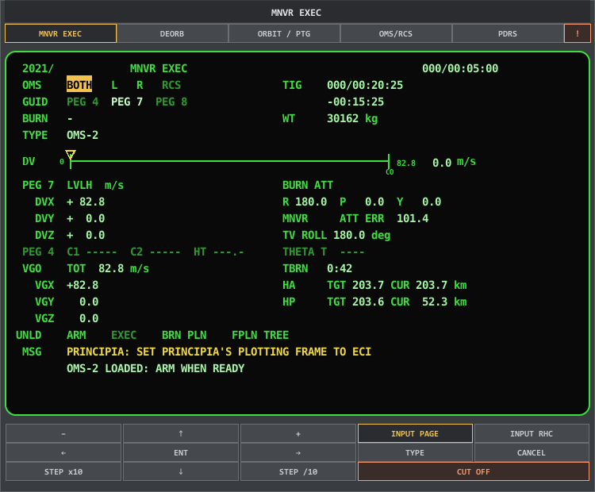

<b>Orbit: BRN PLN and FPLN TREE, planning your own burns</b>

**BRN PLN (2023/)** plans a burn of your own. It solves as you change an input, and it never touches the orbiter until you LOAD it.

| Item | What it is |
|---|---|
| FPLN STATE | The orbit the burn is planned from: 0 CURRENT is the live orbit; + and - walk through the burns in the tree, so you can plan a second burn after the first; ENT opens FPLN TREE |
| TYPE | CIRC circularises at the burn point; HA sets the apoapsis to a typed value; HP sets the periapsis; PLANE changes the inclination to a typed value; DV is a burn you type as DVX, DVY and DVZ |
| WHEN | Where the burn happens: APO (apoapsis), PERI (periapsis), AN (ascending node), DN (descending node), TIME (a mission elapsed time you type) or T+ (a time from now, which slides with the clock) |
| TIG, BRN+ | The time, and (once FPLN STATE is above 0) the time from the end of the last planned burn to the start of this one (yellow and negative if they would overlap) |
| TGT | The typed targets (HA, HP in km; INC in degrees) for the types that use them; the others are dim |
| BURN | DVX, DVY, DVZ; TOT, TBRN (planned length), WT |
| AFTER | HA, HP and INC of the orbit after the burn. The note beside it says which solve made the numbers: KEPLER (the fast two-body solve, redone on every change) or N-BODY (the slower solve that flies the real coast with Earth's shape and the Moon and Sun; the page says `N-BODY ...` while it runs) |
| Orbit view | The current orbit solid, the planned orbit dashed yellow, a tick where the burn happens |

| Button | Does |
|---|---|
| SOLVE | Runs the n-body solve |
| SAVE → FPLN | Puts the burn in the flight plan as a new branch of the tree |
| LOAD → MNVR | Loads the burn into MNVR EXEC (it also saves it) and shows that page. LOAD → MNVR stays dim unless FPLN STATE is 0 CURRENT: a burn planned from a later burn's orbit cannot be loaded |

**FPLN TREE (2024/)** is the flight plan as a tree. Node 0 is the orbit now; each other node is a burn planned from the state after its parent's burn. A node with two or more children is a branch, and burns are named by their depth and branch letters (1A, 1B, 2AA ...). The path from the top to the end of the selected chain is the active path, drawn bright. `PATH` at the top shows it with the position in the tree, and arrows at the page edges say there is more to scroll to. Each node shows its type with its total dV and the orbit (HA x HP, km) after it. Below the tree, SEL shows the selected burn: its TIG, DV and the orbit after.

| Button | Does |
|---|---|
| Four arrow buttons, ENT | Move over the tree; ENT on a node selects it |
| SET PATH | Makes the selected chain the active path and loads its first burn into MNVR EXEC |
| PLAN FROM HERE | Opens BRN PLN planned from the selected burn's state |
| DELETE | Removes the selected burn and everything under it (never node 0, never a Principia burn) |
| COPY → BRN PLN | Copies a burn into BRN PLN as a DV burn to edit |

A burn flown drops its sibling branches from the tree. Burns marked "P" are Principia's own flight plan burns, mirrored here read only (nothing is sent back to Principia).

<b>Orbit: DEORB TGT, planning the deorbit</b>

DEORB TGT (2022/) plans the deorbit burn. Any time in orbit:

| Step | You | What the page does |
|---|---|---|
| 1 | Pick the SITE: KSC SLF (the Shuttle Landing Facility), EAFB (Edwards) or VBG (Vandenberg). Pick the runway end: AUTO (the planner picks) or one of the site's two ends (SLF15 / SLF33, EAFB06 / EAFB24, VBG14 / VBG32). Pick MODE: FULL (the full planner, with an entry simulation) or COARSE (faster, less exact, for when the entry guidance can absorb the difference) | Previews the pass in the PASS field (pass 1 at first) over each runway end: the runway, the time until the pass (hours:minutes), the heading alignment cone turn and the crossrange. `COMPUTING THE NEXT PASS ...` (`COMPUTING PASS <n> ...` for pass 2 to 4) shows while it works |
| 2 | Press SOLVE | Plans the pass in the PASS field and shows the solution (below) |
| 3 | SAVE → FPLN, or LOAD → MNVR | SAVE adds the plan to the flight plan tree. LOAD loads it into MNVR EXEC as a PEG 4 burn and shows that page |
| 4 | On MNVR EXEC: ARM, EXEC | When the deorbit burn is flown, the OPS3 item opens |

The payload bay doors close by themselves: MNVR EXEC shuts them before a deorbit burn (and before an AOA's OMS-2), so you do not need to close them first.

| Field of the solution | What it shows |
|---|---|
| FPLN STATE | The orbit the deorbit is planned from: always 0 CURRENT, the live orbit (it cannot be changed on this page; BRN PLN can plan from a later burn) |
| PLAN | The runway |
| PASS n of 4, NEXT PASS | The pass the preview rows (RWY, IN, HAC, XRNG) and the solution are for. Plus and minus change n, or TYPE a number from 1 to 4. NEXT PASS goes to the next pass, before a SOLVE as well as after one |
| HAC OVHD | The heading alignment turn in degrees, with TURN OK or TURN HIGH (yellow: the turn is larger than the warning level) |
| ENTRY FPA | The entry flight path angle, degrees |
| RANGE | Kilometres from the entry interface to the site |
| XRNG, MAX | The crossrange to the site and the most crossrange the entry can fly |
| PEG 4 HT, THETA T | The burn's targets |
| TIG, DV, TBRN, WT | The burn's ignition time, dV (m/s), length and mass |
| MISS, TOL | How far the plan is from its target, and the tolerance (km) |

CLEAR throws away the last solution, its saved tree burn and its loaded burn (if the burn is loaded in MNVR EXEC it asks to be pressed twice, within 8 seconds). Changing the site, runway, mode or PASS clears the solution rows until you SOLVE again (the page shows the pass preview meanwhile); a new site starts at AUTO. Each of these, and CLEAR, puts PASS back to 1. A globe on the right draws the ground track, the entry interface (X), the periapsis (a ring) and the site.

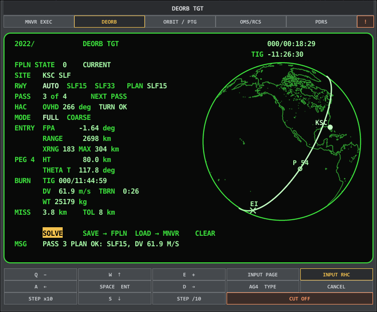

<b>Orbit: ATO / AOA TGT, after an ascent abort to orbit</b>

After an abort that ends in orbit, press OPS2 on the `ops1q` display within 3 minutes (or type `RUN ops2q.`), and in `ops2q` the page row's second button reads ATO / AOA (2025/). The page opens before OMS-1, so you can change your pick until OMS-1 starts to burn; it is open again after OMS-1 until the OMS-2 sequence starts.

| Item | What it shows or does |
|---|---|
| MECO | The orbit and velocity at main engine cutoff: HA and HP (km), VI (m/s) and OMS (the OMS propellant left, kg) |
| ABORT | Why the abort happened: ATO, or ENG OUT, 2 ENG OUT or 3 ENG OUT followed by the time of the first engine out (minutes:seconds). Beside it, ops1 shows the mode `ops1q` picked: ATO when the OMS propellant left after OMS-1 and OMS-2 covers the deorbit reserve, else AOA (`-` when none) |
| ATO column | Abort to orbit: fly OMS-1 and OMS-2 to a safe orbit and stay. Shows OMS-1 and OMS-2 with TIG and DV, TOTAL dV, OMS LEFT (kg, yellow if short), ORBIT (HA x HP), and a STATUS of GO or NO GO with the WHY |
| AOA column | Abort once around: fly the burns and return after one orbit. Shows SITE and TYPE (the landing runway and entry type), OMS-1 and OMS-2 with TIG and DV, TOTAL dV, OMS LEFT, ENTRY FPA, LAND (the landing time) and a STATUS of GO or NO GO with the WHY |
| SELECT | ATO, AOA or AUTO (AUTO picks the mode that is GO). `FLIES ...` names the mode that will fly. After OMS-1 a mode that is NO GO is dim, and ENT on it tells why |
| SOLVE | Plans both columns again |
| LOAD → MNVR | Loads the chosen mode's burn into MNVR EXEC and shows that page |
| LOCKED | Shows once the choice is final: OMS-1 burning, or OMS-2's sequence started (CUT OFF before ignition frees it). After OMS-2 is flown the button goes back to DEORB |

<b>Orbit: ORBIT / PTG, the orbit and the attitude</b>

ORBIT / PTG (2011/) shows the orbit and the orbit DAP, the program that holds the orbiter's attitude.

| Item | What it shows or does |
|---|---|
| ORBIT | HA, HP (km), INC (degrees); H (height now, km) and V (speed, m/s); PER (the orbital period, m:ss), TTA and TTP (the time to apoapsis and to periapsis) |
| HOLD | INRTL: hold the attitude fixed in space. LVLH: hold it fixed against the local horizon, so the orbiter turns once an orbit. TRACK: point a body axis at Earth or the Sun. FREE: no control, the orbiter drifts |
| TRACK items | BODY, the body axis (+X nose, -X tail, +Y right wing, -Y left wing, +Z down, -Z the payload bay's up); TO, the target (EARTH or SUN); OMICRON, the roll about the line of sight, degrees |
| Attitude table | For ROLL, PITCH and YAW, in degrees: CUR is the attitude now in the local frame; MNVR is a typed attitude you can turn to; TGT is the DAP's own target and ERR its error |
| RATE | The orbiter's turn rate, degrees per second |
| DAP line | What the DAP is doing (HOLD, MNVR, TRACK, CSS RATE, FREE DRIFT), the error and JETS when the thrusters fire. It reads `BURN: KOS STEERING` (yellow) while a burn steers the orbiter with its own steering instead of the DAP |
| DAP | AUTO (the DAP holds the attitude and turns to the one you give it) or CSS (the stick commands the turn rate) |
| DB | The deadband: the error the DAP allows before it fires, degrees (starts at 0.5). While the DAP flies, it shows the deadband the DAP really uses (0.10 in an OMS burn), not the typed one |
| RATE (DAP) | The turn rate it uses, degrees per second (starts at 2) |
| Orbit view | The orbit round the Earth, with the loaded burn's orbit dashed in yellow |

| Button | Does |
|---|---|
| MNVR | Turns to the typed ROLL, PITCH and YAW and holds there |
| STOP | Stops a turn and holds the attitude it reached |
| BRN PLN | Opens the burn planner |

The AUTO DAP flies every attitude turn and TRACK. Selecting TRACK while in CSS switches the DAP back to AUTO. If the AUTO DAP fails (AUTO DAP LOST), only CSS is left.

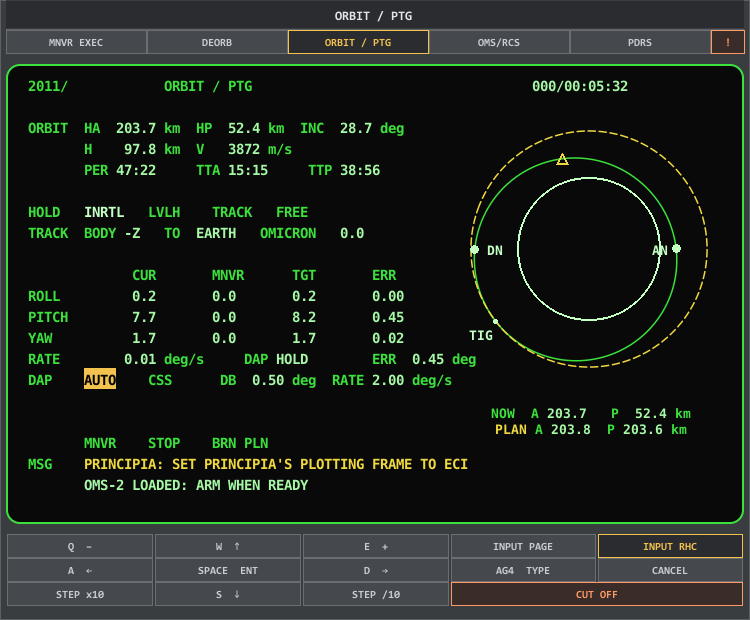

<b>Orbit: OMS/RCS, engines, thrusters, propellant</b>

OMS/RCS (2011/) reports the orbital maneuvering system (the two OMS engines, L and R) and the reaction control system (the thrusters, in three pods: F forward, L left aft, R right aft) and runs a few of their controls.

| Block | What it shows or does |
|---|---|
| OMS L and R | STATUS: ON when firing, ARM when ready, OFF when the burn sequence shut that engine down for a single-engine burn, FAIL in red when out. Pc % (chamber pressure: how hard it burns), THRUST in kilonewtons, GMBL P and Y (the engine's gimbal angles, degrees), OX % and FU % (oxidizer and fuel left in the tanks that feed the engine) |
| RCS F, L and R | QTY % (monopropellant left in the pod's tank, yellow below 10; L and R share the aft tank), JETS (working over total: the orbiter's own thrusters, not a payload's), FAIL (jets failed, in red), VERN (ON while JET SEL is VERN; OFF in dim while it is PRI; OFF in red when the pod has no RCS available) |
| JET SEL | PRI: the primary thrusters. VERN: the vernier jets; every RCS thrust is cut to 3 %, the DAP's deadband to 0.1 degree or less and its rate to 0.2 degree a second or less (a smaller value you set stays). A burn's own RCS (the rate null) always uses the primaries. PRI restores everything |
| XFER | Moves monopropellant between the forward and aft tanks. BAL % is the forward share now; TGT % the share you want (typed); GO starts the transfer (about 1 % of the total a second). An arrow shows the direction (forward or aft) and the page shows `CANCEL` while it runs: press CANCEL to stop it. It stops by itself within 0.05 % of the target |
| CTRL FRM | The control point: FWD (the forward cockpit, action group 7) or OMS (action group 6). It cannot be changed during a burn sequence (the burn holds OMS); pressing the action group yourself is followed and shown |
| OPS3 | Opens `ops3q` (the entry). Dim until a deorbit burn, or an AOA's OMS-2, has been flown (`DEORBIT BURN NOT FLOWN`). Once it is lit, the left arrow from JET SEL's PRI or from XFER's TGT % moves the cursor to it |
| Pc tapes | Two tapes show each OMS engine's Pc: the triangle is the commanded Pc, the square the actual, 0 to 100 %. A tape turns red at once when the engine is out. It also turns red when the engine burns below 80 % of its command, but only from 1.5 s after ignition, while the engine spools up |
| RCS CMD lamps | PITCH up and down, ROLL left and right, YAW left and right: lit when the DAP commands the thrusters on that axis |

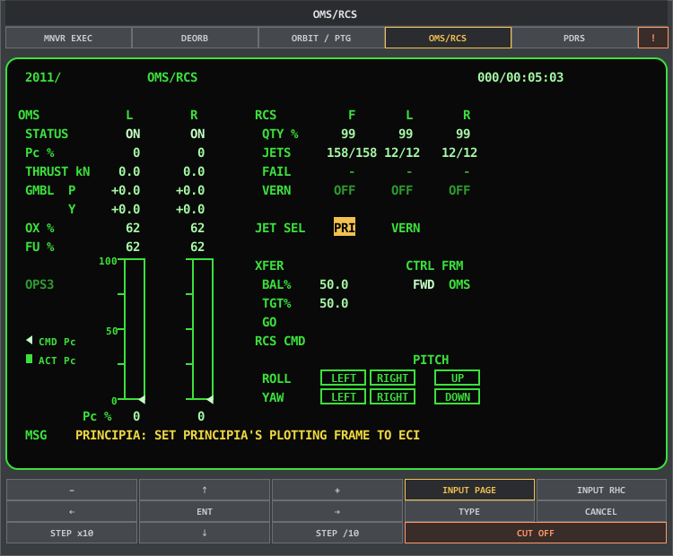

<b>The Canadarm: the PDRS CONTROL page</b>

The Canadarm has no program of its own: it runs on `ops2q`'s PDRS CONTROL page. The arm comes up when you open the page and stops when you leave it, except that an AUTO sequence keeps running if you leave. The orbiter keeps running the orbit DAP in PDRS. Craft with the arm need htRobotics and Breaking Ground.

| Row / item | What it shows or does |
|---|---|
| MODE | SINGLE (one joint at a time), MAN AUG (the hand controllers drive the arm), OPR CMD (you type a position for the end effector) or AUTO (a stored sequence). AUTO is dim and cannot be picked here; it is selected while a button of the AUTO row is running a sequence |
| RATE | COARSE or VERN (slow and fine) |
| FRAME | The frame of the hand controllers and typed numbers: ORB UNL (the orbiter, no payload), END EFF (the end effector); with a payload loaded also ORB LD (orbiter with payload) and PL (the payload) |
| LOAD | UNL (nothing on the arm) or LD (a payload loaded, with the number of parts, LATCHED once latched, and its MASS in kg) |
| Payload thrusters | A payload's own RCS thrusters are held off while it is in the bay, on the arm or docked, and the OMS/RCS page does not count them. They work again once the payload is free |
| Point of resolution | CUR, CMD and RATE for X, Y, Z (m) and P, Y, R (deg); typed commands in OPR CMD |
| The six joints (SY, SP, EP, WP, WY, WR) | Each shows its position, commanded angle and rate. In SINGLE a typed target slews that joint, and several joints can slew at once. The cursor skips a joint's CMD cell: move it to the joint's toggle and press TYPE to reach it. The joint does not have to be selected |
| MAN AUG behaviour | A joint driven into its soft stop (5 degrees inside its range) holds there while the others keep moving. The status line says SOFT STOP, then SLIDE, MOVE ONLY, TURN ONLY or BLOCKED for what the arm still does |
| Arm under load | With a payload on the arm every joint is held on its command; a joint the load pushes off its command is pulled back slowly |
| MPM | STOW (12 degrees), DEPLOY (30) and CENTER (0) for the mounting roll joint, with a word at the right for where it is (STOWED, DEPLOYED, CENTER, or MOVING / BETWEEN in yellow). Dim on a craft with no MPM roll servo |
| RELEASE | The end effector lets go of a captured payload and backs away along its line |
| Poses | STOW, PRE-CR and READY: the arm drives itself there |
| AUTO 1 to AUTO 4 | Stored arm paths; an unused one reads ---- |
| ROT | RHC (the rotation hand controller turns the end effector) or THC (the translation hand controller does) |
| PROX OPS | OFF; STKP (null the velocity to a target vessel or docking port, then hold station); CSS (the stick moves the hold point). TRANS: NORM or PULSE. STICK: ARM or ORB. Shows the target's range, range rate and error |
| Message rows | The arm's own messages and the PROX OPS readout |
| EE CAM (pad cell) | Puts the flight camera on the end effector; press again to go back |
| STOP (pad cell) | Ends every mode and hands the hand controllers back |
| GRAPPLE, CAPTURE | The automatic capture of a payload: dimmed in 1.0 and do nothing |

**Handling a payload by hand** Fly the end effector with MAN AUG or OPR CMD (PROX OPS can hold station beside a target while you line up) until its docking node reaches a grapple fixture, a docking port on the payload. The docking mechanism captures it and LOAD changes from UNL to LD. Every rate is then slower, the heavier the payload. A payload still latched in the bay holds the arm still until RELEASE lets it go.

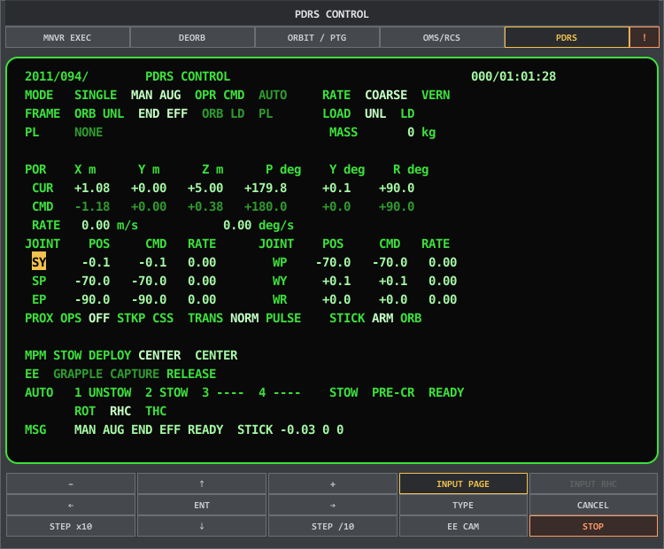

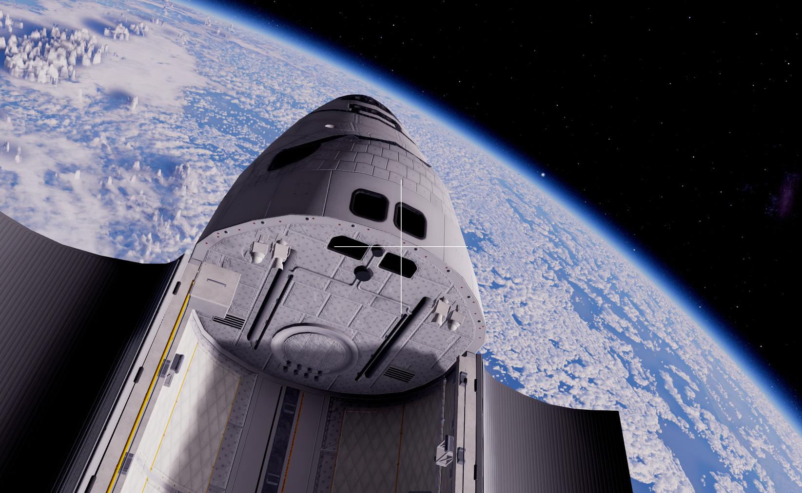

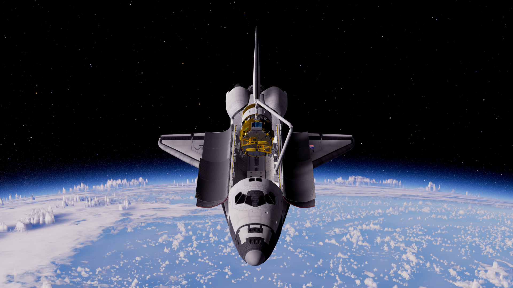

<b>Entry: ops3q, ENTRY TRAJ and HORIZ SIT</b>

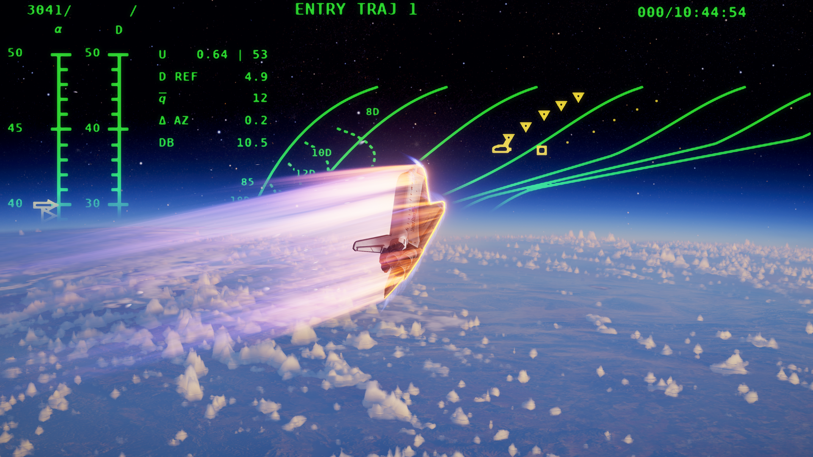

Press ENT on the OPS3 item in `ops2q`'s OMS/RCS page (it opens after a deorbit burn). `ops3q` starts on the coast to the entry interface (it warps and sets the entry attitude itself), then flies entry guidance, TAEM, approach and landing, and rollout. Entry pages use imperial units. Two windows open one above the other: ENTRY TRAJ on top and HORIZ SIT below it. Each window has its button rows between its title and its page.

**ENTRY TRAJ** plots velocity against range to the runway. The vertical axis is velocity, high at the top; the horizontal axis is range to go, growing to the right. It has five pages, ENTRY TRAJ 1 to 5, and changes page by itself as your velocity falls. The page name is across the top of every page, with the mission clock at the top right.

| Page | Velocity band (ft/s) |
|---|---|
| ENTRY TRAJ 1 | Entry interface (about 12,400) to about 9,250 |
| ENTRY TRAJ 2 | About 9,250 to about 8,000 |
| ENTRY TRAJ 3 | About 8,000 to about 6,560 |
| ENTRY TRAJ 4 | About 6,560 to about 4,370 |
| ENTRY TRAJ 5 | About 4,370 to 2,500 (where TAEM starts) |

The alpha scale is 25 to 50 degrees on pages 1 to 4 and 10 to 35 on page 5. The band edges between pages 1 and 4 move a little with the entry speed.

| Element | What it shows |
|---|---|
| Alpha scale (left) | The angle of attack in degrees; an arrow shows the command from guidance, a triangle the real value; a marker that is off the scale flashes |
| D scale (left) | Drag in feet per second squared, 0 to 50; an arrow for the command, a triangle for the real value; a marker that is off the scale flashes |
| Solid lines | Range against velocity for an entry flown at one constant bank angle, labelled 85, 72, 60, 48, 36, 24 and 0 degrees. The 85-degree line is labelled G-LIM where the load limit takes over from the bank limit |
| Dashed lines | Constant drag, each labelled with its drag (for example `30D`) |
| The orbiter's symbol | Your present range and velocity, with a short trail |
| The box ahead | Where the bank guidance wants now would take you; the gap between the box and the symbol is the correction guidance is applying |
| The symbol flashes | While guidance reverses the bank (the azimuth error passed the deadband), or while the symbol is off the page |

| Readout (top left) | What it shows |
|---|---|
| U | The guidance's bank variable, with the bank angle after the bar |
| D REF | The reference drag, ft/s² |
| Q-bar | The dynamic pressure, psf |
| ΔAZ | The azimuth error to the runway, degrees |
| DB | The azimuth deadband, degrees. When ΔAZ passes DB, guidance reverses the bank |

| Readout (lower right) | What it shows |
|---|---|
| Ḣ BIAS | The guidance's correction to the reference bank, degrees, with its sign |
| ROLL REF | The reference bank, L or R |
| CMD | The bank commanded, after the rate limit |
| BANK | The bank you have |
| MACH | Mach number |
| H | Height, kft |
| Ḣ | Climb rate, ft/s |
| TRIM | The body flap as U (nose up) or D (nose down) with its size, then the elevon trim when the elevons carry any load |
| LOAD FAC | The load factor, in g |

After a TAL abort the page comes up before the entry interface on stand-in panels, with no bug at first. Once the entry family is ready the bug appears, its horizontal place standing in for range, and the page then switches by itself to the live panels, where it stands at the real range (see "Ascent aborts"). With guidance lost the commanded values read `----`.

**HORIZ SIT** is a map of the ground track, drawn track-up (the direction you are heading is up).

| Element | What it shows |
|---|---|
| Orbiter's symbol | Fixed near the bottom of the map |
| Scale | Steps by itself through 2000, 1000, 500, 250 and 100 NM to the tightest that still holds the runway; the scale is written on the map |
| Range rings and runway | Rings around the runway; the runway is a bar with a landing arrow; the nearest alternate runways are shown by name |
| Two lines from the orbiter | At the azimuth deadband either side of the track; they brighten while the azimuth error is larger than the deadband (the reversal) and flash with the symbol on ENTRY TRAJ |
| Five circles ahead | The predictor: where you will be if you hold the present bank |
| Left block | RWY (the target runway), HAC (the heading alignment circle: blank until the plan's HAC is set, then L OVHD or R OVHD for the side of the circle), RANGE (to the runway, NM), XRNG (cross range, NM), DELAZ (azimuth error, degrees), TRK (ground track, degrees) |
| ATT rows | Your attitude in R, P and Y, in degrees, each with a side letter (L or R for roll and yaw, U or D for pitch) |
| GUID rows | What guidance wants for roll and pitch; with guidance lost, `----` |
| RATE bars (right) | The roll, pitch and yaw rates, with the commanded rate from the autopilot |
| ERROR bars | Where to steer |

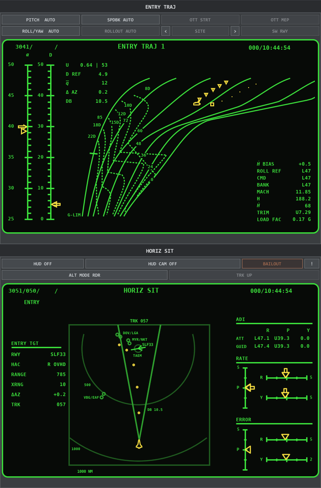

<b>Entry: the buttons, and how entry hands over to TAEM</b>

| Button | Does |
|---|---|
| PITCH, ROLL/YAW | Switches that axis between AUTO (guidance flies it) and CSS (the stick), as on the ascent pages. The guidance keeps running and the page keeps showing its command |
| SPDBK AUTO / CSS | Speedbrake. In AUTO the guidance flies the brake. In CSS the throttle lever flies it, and 100 % throttle is speedbrake shut. Action group 3 switches from AUTO to CSS. With stock aerodynamics, in CSS and before the throttle lever has been moved, it then opens and shuts the brake. Under FAR action group 3 is not read, so use this button and the throttle lever |
| HUD | Shows or hides the HUD |
| HUD CAM | Snaps the camera to the HUD's eye point and back (the HUD's symbols need it) |
| ALT MODE | The HUD's altitude source (RDR or RWY) |
| BAILOUT | Grey during entry; it goes live when TAEM starts. Gives up on landing on a runway and lets the crew bail out instead; two presses, 1 to 5 s apart; no undo |
| ! | Opens the FAILURES window (see "Failures: the FAILURES window and its keys") |

The TAEM buttons (OTT STRT, OTT MEP, SW RWY, `< SITE >` and TRK UP) are grey in entry and open when TAEM starts. A "!" in a button's label means guidance recommends it.

**From entry to TAEM** Entry guidance ends at about 2,500 ft/s (762 m/s), below 12 km altitude, or within 35 km of the runway threshold at Mach 4 or less (a long entry that is still fast). Then the same program changes the two windows to VERT SIT (top) and HORIZ SIT (bottom). Before that the program holds the entry attitude and flies the bank reversals itself; you only fly if you switch an axis to CSS.

<b>TAEM: VERT SIT, the vertical situation display</b>

`ops3q` flies TAEM after entry; so does `ops6q` (after a TAL or a GRTLS). The top window is VERT SIT, a side view of the energy corridor; the bottom window is HORIZ SIT (see the next block). The HUD is on by default from TAEM.

TAEM has four phases, named on the message row under the page title.

| Phase word | Means |
|---|---|
| S-TURN | Shedding energy in a turn when high |
| ACQ | Acquiring the heading alignment circle |
| HDG | Flying the circle |
| PRFNL | Prefinal |

The message row also shows ZOOM while guidance is flying a zoom, and the alert from guidance (the OTT message). The mission clock is at the top right.

| Message row word | Means |
|---|---|
| ZOOM | Guidance is pulling up (a load factor up to 0.45 g higher) to bleed off speed, because the orbiter is too fast to turn onto the HAC at its bank limit. It needs Mach above 0.95, dynamic pressure above about 63 psf, energy above nominal and 20 degrees or more of turn still to make, and is never used in the S-turn |

| Element | What it shows |
|---|---|
| VERT SIT 1 | Range against height, with the energy lines S-TURN, NOMINAL and MAX L/D drawn across it (the guidance's energy limits: high on the S-TURN line, low toward MAX L/D). The range is the distance still to fly along the planned path to the approach and landing interface, a short way before the runway |
| VERT SIT 2 | Replaces VERT SIT 1 inside about 24 NM and runs in to the approach and landing interface |
| On the plot | The orbiter's symbol with its predictor dots; an energy box, the MEP mark and an alpha / Mach box appear as they are needed |
| SPD BK, CMD | The speedbrake you have, and the speedbrake commanded, in percent (100 is the full brake) |
| NZ, TGT NZ | The load factor, and the commanded load factor, in g |
| QBAR, QREF | The dynamic pressure, and the reference dynamic pressure, in psf |
| MACH | Mach number |
| E/W bar (far right) | The energy over weight against the nominal. The marks beside it: NOM (nominal), the upper and lower energy limits, STN (the S-turn line) and MEP |
| OTT message | `OTT STRT` or `OTT MEP` when guidance recommends one |

| Button | Does |
|---|---|
| OTT STRT | Takes the heading alignment circle from overhead to a straight-in approach. Live in the S-turn and the acquisition phase until 60 s before the HAC; it shows a "!" while guidance recommends it. Once taken, the same button changes to OTT OVHD and undoes it |
| OTT MEP | Moves the aim point to the minimum entry point, for when the energy is low. Live in the same phases until 40 s before the HAC; it shows a "!" while guidance recommends it. Once taken, the same button changes to OTT NEP and undoes it |
| SW RWY | Switches to the runway's other end and its straight-in approach; its label carries the other end's number, and a press again switches back |
| `< SITE >` | The two arrows browse the nearby runways in a fixed order and the middle button takes the one shown (it reads `SITE <runway>` for the runway you are flying, and `TO <runway> <distance> NM` for another one) |

A button shows "..." until guidance has answered its press on its next cycle (about once a second). PITCH, ROLL/YAW, SPDBK and the HUD buttons work as in entry. BAILOUT, grey in entry, is live from here until approach and landing.

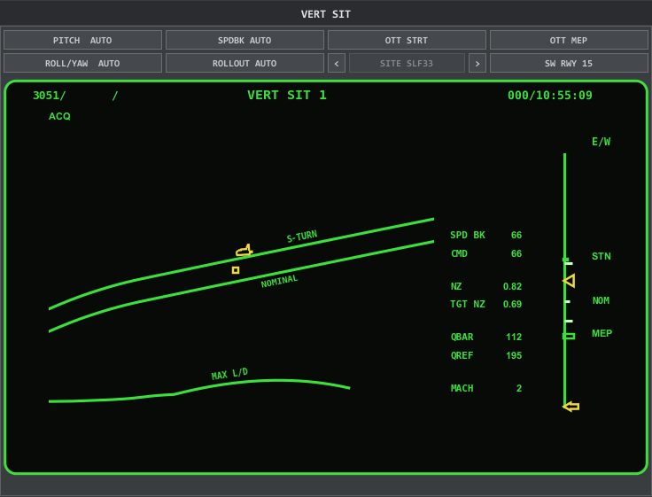

<b>TAEM: HORIZ SIT, the horizontal situation display</b>

HORIZ SIT is a map of the runway, the heading alignment circle (HAC) and your track. The runway, its centreline and the HAC are drawn on it; where the whole circle does not fit, the circle is drawn as dashes. With TRK UP (the default) your ground track points up the page and the runway turns with you; pressing it changes the button to RWY UP and fixes the runway at the top of the page.

The scale bar at the lower left reads 50, 30, 10, 3 or 1 NM, from the widest page to the closest; the 1 NM page takes over in the last 20 s before the HAC. The display picks the smallest scale that holds you and the circle. The 50 and 30 NM pages show when the orbiter is still far from the runway, as it is at the start of an RTLS or GRTLS.

| Element | What it shows |
|---|---|
| TAEM TGT (left block) | RWY (the runway); HAC (L or R for the side of the circle, STRT or OVHD for straight-in or overhead); EP (NEP for the nominal entry point, MEP for the minimum entry point); HAC TURN (the turn still to fly, degrees); RANGE (the distance still to fly along the planned path to the approach and landing interface, NM); HDG ERR (the heading error in the acquisition phase, degrees) |
| Bar above the map | Counts the time to the HAC in the last 20 s (marks 0, 5 and 10 s); in the heading phase it shows the radial error (5K = 5,000 ft at the ends) and in prefinal the cross-track (2.5K = 2,500 ft at the ends) |
| GS bar (right) | The glide slope indicator: the orbiter's height above or below the guidance's reference height, in feet (5K at each end); the pointer rises when you are below the reference |
| MESSAGES (right) | The 13 newest events, the newest at the top: each is the time since the pages opened (minutes:seconds) and up to 22 letters, for a phase change (S-TURN, ACQ, HDG, PRFNL) or a guidance message such as `OTT STRT` |

The bar above the map is a FLY-AWAY bar. When it shows an error (the heading phase and prefinal), its pointer moves toward the side you are off to, so you steer away from the pointer to bring it back to the centre. The GS bar is a FLY-TO bar. Its pointer rises when you are below the reference height, so you steer toward the pointer.

| Button row | Buttons |
|---|---|
| First row | HUD, HUD CAM, BAILOUT and "!" (opens the FAILURES window) |
| Second row | ALT MODE (RDR or RWY: which height the HUD uses) and TRK UP or RWY UP |

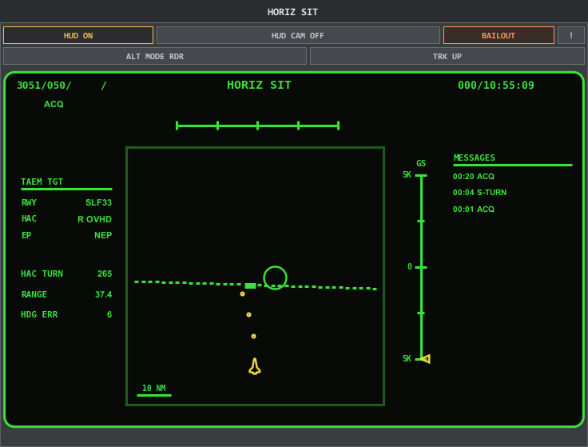

<b>Approach, landing and rollout: the HUD and the last buttons</b>

The same program flies approach and landing, and rollout, down to wheels stop. There are no more pages to read: the HORIZ SIT and VERT SIT windows keep only their button rows, and the HUD is what you watch. You can fly pitch, roll/yaw or both by stick at any time (PITCH and ROLL/YAW switch each axis to CSS); SPDBK and BAILOUT work as in entry.

| Button | Does |
|---|---|
| ROLLOUT AUTO / CSS | AUTO: after main-gear touchdown the orbiter derotates and steers to the runway centreline with differential braking and the rudder. CSS: you steer with the yaw stick (differential braking) and push the nose down; pushing the yaw stick past half deflection for 0.3 seconds takes the rollout from AUTO |
| HUD, HUD CAM, ALT MODE | As in TAEM |

| HUD symbol | What it shows |
|---|---|
| Boresight, velocity vector | Where the nose points; where the orbiter is going |
| Horizon and pitch ladder | The rungs only above 4000 ft |
| Speed and altitude tapes | KEAS and height |
| R or W tag | R: the height is the radar's (ALT MODE RDR, below 5,000 ft). W: it is the height above the runway (ALT MODE RWY, below 5,000 ft). It stands right of the GSI when one is drawn, else right of the altitude readout |
| Speedbrake | Actual and commanded |
| Control mode | CSS or AUTO |
| Runway outline | Drawn over the real runway; action group 4 toggles it, and the HUD CAM button must be on for it to line up |
| Flight director square and guidance diamond | Before prefinal: fly the square onto the diamond |
| GSI | The glide slope indicator, beside the altitude tape: height above or below the glide slope |
| Phase word | On the speedbrake row |
| ZOOM | Beside the control mode |
| G meter | Beside the flight director square |
| Guidance messages (GO CSS, OTT STRT, OTT MEP) | At the top |
| Preflare triangles, outer glide slope (OGS) cue | At approach and landing, either side of the velocity vector; below 50 ft the diamond and these cues go out |
| Groundspeed and braking cue | After the nose gear is down |

`hud_cal.ks` calibrates the HUD's eye point and flies nothing.

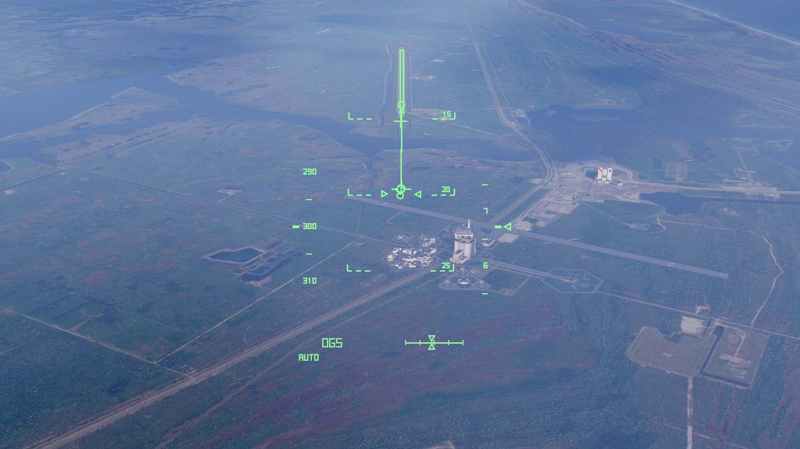

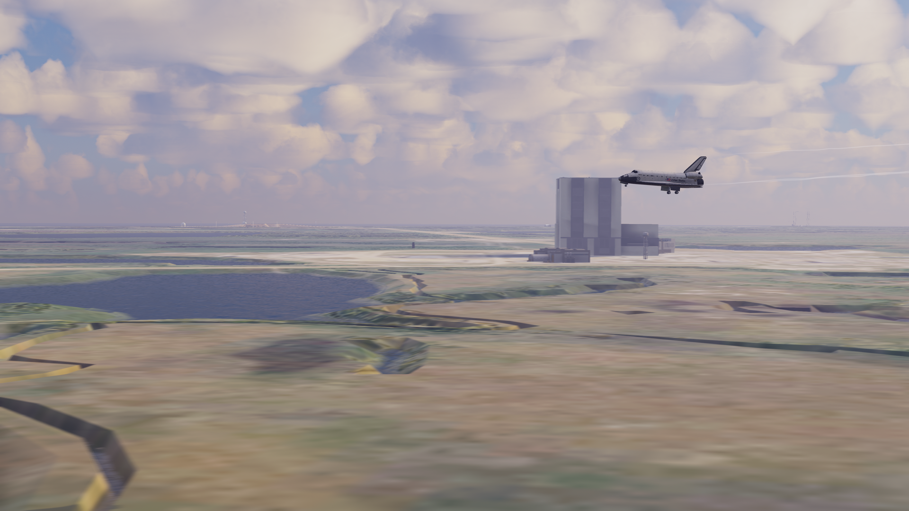

## When things go wrong

<b>Failures: the FAILURES window and its keys</b>

KAL/S can fail the orbiter when a player selects it; by default nothing fails. The "!" button on the ascent pages, on `ops2q` and in the entry and landing button rows of `ops3q` opens the FAILURES window. It looks like a mission control console: small green-and-cyan screens above rows of keys with fixed legends. A key never changes its text; its state shows by its light (amber, green, yellow, red; dark means it cannot be used now). Only the failure types the running program can fly are offered.

| Group | Keys | Does |
|---|---|---|
| Top row | SCHEDULE, RAND, MANUAL | SCHEDULE (lit amber) runs the rows you set, each a failure at a mission elapsed time (MET) or at the time of ignition of a burn (TIG). RAND (lit amber) draws random failures. MANUAL (lit green) is neither: failures happen only when you fire one |
| RAND scale | X0.5, X1, X2, X5, X10, X20 | The scale of the random failures (X1 is the standard rate); the chosen one is lit green |
| FILTER | ALL, MPS, OMS, RCS, FCS, DPS, SW | Narrows the types you can choose: main engines, orbital maneuvering engines, reaction control, flight control, the five general purpose computers, software. A group with nothing this program can fly is dark |
| FAIL NOW (the builder) | MET, TIG, EVENT, CHAIN | Chooses the clock for the row: MET (mission elapsed time) or TIG (time of ignition). EVENT and CHAIN are dark and not available in this release |
| | T -10, T +10 | Move the time by 10 s |
| | TYPE PREV, TYPE NEXT | The failure type |
| | TARGET NEXT, VALUE NEXT, MODE NEXT | The engine, jet, GPC or similar it hits, how much, and the way it fails |
| | FAIL | Fires it at once |
| ROWS | +, CONFIRM, CLEAR ALL | The screen shows the pending rows (`N OF M ROWS`). + adds the row being built; CONFIRM turns SCHEDULE on and hides the window; CLEAR ALL removes the pending rows (anything that has already happened stays) |
| ACTIVE | ACTIVE PREV, ACTIVE NEXT, FIX | Lists what has failed, with a > on the chosen one and the real fix on the next line; FIX starts the fix |

The builder's screen shows the failure being built, the time (WHEN), the type, its target, value and mode, and the answer to the last press.

A failure is permanent unless a real crew could fix it in flight. A timed fix counts down on its row (IN PROGRESS, then DONE on the message line). A refused fix says why on the same screen. A GPC restart waits for MECO. A re-IPL (initial program load) reloads the software pass from its stored copy, and works in orbit only.

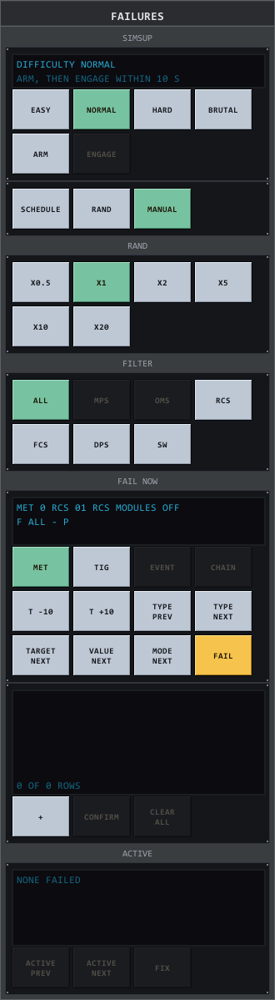

<b>Failures: every failure in plain words</b>

Each failure has a code (in brackets, as the FAILURES window shows it), a plain name, the targets you can aim it at and what it does. A fix, where there is one, is the real crew action and takes the time shown. There are 21 failures.

| Failure | What happens | Target (and value) | Fix |
|---|---|---|---|
| A main engine shuts down (MPS 01) | One main engine stops thrusting | Left, centre, right or any | None |
| A main engine's thrust is low (MPS 02) | One main engine cannot throttle up to full | Left, centre, right or any; 60 % or 75 % | None |
| A main engine's gimbal is locked (MPS 03) | One main engine cannot swivel to steer | Left, centre, right or any | None |
| An orbital maneuvering engine shuts down (OMS 01) | One OMS engine stops thrusting | Left, right or any | None |
| An orbital maneuvering engine's thrust is low (OMS 02) | One OMS engine delivers less thrust | Left, right or any; 70 % or 85 % | None |
| An orbital maneuvering engine's gimbal is locked (OMS 03) | One OMS engine cannot swivel to steer | Left, right or any | None |
| An orbital maneuvering propellant leak (OMS 04) | An OMS tank loses propellant | Fuel, oxidizer, both or any; 0.05 or 0.2 kg/s | Isolate the tank (5 s) |
| Reaction control jets are off (RCS 01) | The jets of a pod, or of one manifold of a pod, stop | A pod (forward, left or right, all of it) or one manifold (1 to 4) of a pod, or any | Re-open the manifold valves (5 s) |
| Reaction control thrust is low (RCS 02) | The jets of a pod or manifold deliver less thrust | A pod or a manifold as above, or any; 50 % or 75 % | None |
| A reaction control propellant leak (RCS 03) | A pod's tank loses propellant | Forward, left, right or any; 1 % or 5 % a minute | Close the manifold (5 s) |
| A single jet is stuck (RCS 04) | One named jet stays off or stays on | The jet you name (pod, manifold and exhaust direction: F1F to R4R); stuck off or stuck on | Close the manifold (5 s) |
| A control surface is frozen (FCS 01) | One surface stays where it is | Elevon 1 to 4, body flap, left or right rudder half, or any | None |
| A computer fails for good (DPS 01) | One general purpose computer (GPC) is lost | G1 to G5 or any | None |
| A computer has a momentary fault (DPS 02) | A GPC drops out for a while | G1 to G5 or any | Restart it (65 s) |
| A computer fails to synchronise (DPS 03) | A GPC will not stay in step with the others | G1 to G4 or any | Restart it (65 s) |
| A computer's output is bad (DPS 06) | A GPC sends wrong data | G1 to G4 or any | Restart it (65 s) |
| The redundant set splits in two (DPS 04) | Two pairs of GPCs disagree | The 2-2 split | Pick the pair (3 s) |
| A software pass fails (DPS 05) | The primary software fails on every GPC that runs it | G1 to G4 | BFS ENGAGE until the primary software loads again by itself in orbit (20 s) |
| The autopilot is lost (SW 01) | The automatic control of an axis stops and only the stick flies it | Ascent, orbit or entry | Restart the software (10 s) |
| Guidance is lost (SW 02) | The guidance stops giving commands and its readings show `----` | Ascent, entry, TAEM, approach and landing, or the entry alpha modulation | Restart the software (10 s) |
| A display fails (SW 03) | One page freezes or goes blank | A page; frozen or blank | Select the page again (2 s) |

<b>Failures: the caution and warning panel and the GPC keys</b>

**The caution and warning panel** opens by itself at the first caution or warning, in the same place in every program (drag it and the new place is remembered). It shows 12 lamps in four columns and three rows. A lamp lights amber for a caution and red for a warning, and stays lit while its fault lasts. Under the lamps a screen lists the fault rows, newest first, in the colour of their class.

| Row of lamps | Lamps |
|---|---|
| 1 | LEFT OMS, RIGHT OMS, OMS PRPLT (OMS propellant), MPS (main engines) |
| 2 | FWD RCS (forward RCS), LEFT RCS, RIGHT RCS, RCS JET |
| 3 | FLT CNTL (flight control), GUID (guidance), GPC, ARM |

**Attitude error in orbit** FLT CNTL cautions `DAP ATT ERR` when a held attitude stays off by more than five times the DAP's deadband (at least 0.5 degree) for 5 s. In a burn, from ignition to cutoff, the limit is 1 degree. A hold more than 20 degrees off for 2 s is a warning.

| Control | Does |
|---|---|
| MASTER ALARM (in the title bar) | Flashes red with a two-tone alarm until you press it. The press acknowledges every row and the SM ALERT light too; there is no separate acknowledge button. Acknowledged rows go back to green and the lamps stay lit while the fault lasts |
| SM ALERT | A software alert: its own SM ALERT light comes on with its text and a single steady tone. It is not one of the 12 lamps and does not sound the master alarm. MASTER ALARM puts it out |
| MSG RESET | Removes the acknowledged rows whose fault is over |
| HIDE | Closes the panel; the next fault opens it again |

**The GPC keys** appear in the FAILURES window where a general purpose computer (GPC) has failed: one strip for each failed GPC, up to four at once. A strip shows the failed GPC, its failure, the GPC it can be re-assigned to and the task under way, over four keys. A key lit amber is allowed now; a dark one is not. A window whose GPC has failed freezes on its last picture and then shows a large X. The failures themselves are in the DPS filter above.

| Key | Does |
|---|---|
| RE-ASSIGN | Moves the failed GPC's display to another GPC |
| LOAD JOB | Moves the failed GPC's job to G3. It works in orbit only, takes 30 s, is refused for G3 and G5, and moves one job at a time |
| SWAP SPARE | Swaps in the spare GPC for a hardware failure (in orbit, once per flight; takes 60 minutes) |
| RESTART | Restarts a GPC that failed only for a moment (a transient failure); in ascent only after MECO |

**The pass-set keys** appear in a second strip while the four primary GPCs disagree 2-2 (DPS 04, strip "SET SPLIT 2-2: G1+G2 / G3+G4") or the primary software has failed on all of them (DPS 05, strip "PASS FAIL: G1-G4 DOWN"). A key lit amber is allowed now.

| Key | Does |
|---|---|
| PAIR 1-2, PAIR 3-4 | DPS 04 only: picks the pair you trust. One pair is right and nothing on the screen says which. The wrong one is refused (`PAIR n DISAGREES`) and the keys stay dark while the set votes again for 15 s; the right one takes the set, which reforms after 3 s |
| BFS ENGAGE | Hands the flight to the backup flight system, the fifth GPC (G5). Guidance and AUTO come back, but on one display window only; the other keeps the big X. Refused when G5 has failed or the pair is already picked |
| BFS DISP | While the backup flight system flies in ascent or entry: moves it to the other of the two display windows (not in orbit) |

There is no key for a DPS 05 reload: the primary software is loaded again by itself when `ops2q` starts (20 s), so until then BFS ENGAGE is the way to keep flying.

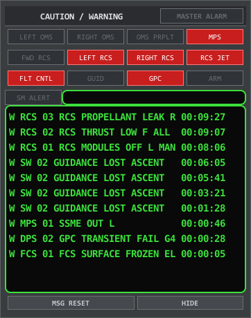

<b>SIMSUP: the simulation supervisor</b>

SIMSUP acts as a real SimSup (simulation supervisor) would in a simulator training mission, triggering failures while keeping the mission possible. Its keys are the top section of the FAILURES window. It draws its own failures, including several at once and, on the ascent, engine-out sequences through every abort mode, always where a landing or an orbit is still possible, and it also runs 30 scripted failure scenarios.

| Key | Does |
|---|---|
| DIFFICULTY: EASY, NORMAL, HARD, BRUTAL | The chosen one is lit green (NORMAL is the default); see the table below |
| ARM (amber, "ONE WAY FOR THIS FLIGHT") | Starts a 10 s window |
| ENGAGE (red) | Lit only within those 10 s; pressing it latches SIMSUP on for the rest of the flight |

Once latched the screen reads `SIMSUP ACTIVE`. The rows are discarded and SCHEDULE, RAND, FILTER, FAIL NOW and ROWS go dark. ACTIVE and the GPC keys stay in your hands, with every real fix.

| Level | Failures drawn in each of ascent, orbit and entry | Other |
|---|---|---|
| EASY | 1 to 2 | At least 120 s between two failures (360 s in orbit) |
| NORMAL | 3 to 4 | At least 60 s between two failures (180 s in orbit) |
| HARD | 5 to 6 | At least 30 s between two failures (90 s in orbit). Two failures can come within 20 s of each other |
| BRUTAL | As many as the mission survives | No spacing limit, though failures are spread out; more of them permanent (an AUTO DAP or guidance that stays lost, so you fly by hand); two failures can come close together |

<b>Troubleshooting</b>

| Symptom | What to do |
|---|---|
| `RUN kals_test.` says `KAL/S NOT READY` with a FIX line about the addon, or programs run slowly | The C# addon did not load: check kOS is 1.6.0.1, run `INSTALL.bat` again, and look for a `[KalsCoproc]` line in KSP.log. Without the addon the flight programs fall back to kOS arithmetic, which is much slower, and SIMSUP and PROX OPS do not work |
| `RUN ops1q.` says the file is not found | Turn on "Start on the archive" in kOS's difficulty options, or type `SWITCH TO 0.` in the terminal |
| The display GUI stays after Ctrl+C | Type `clearguis().` |
| The HUD font is Arial, or the HUD is the wrong size | Run `INSTALL.bat` again (fonts, screen size), and check `display.txt` |
| CKAN installed kOS StockCamera 0.2 | Uninstall it, then run KAL/S's `INSTALL.bat` (it installs StockCamera 0.3.1 with Holo HUD) |
| A vessel landed near the Cape moved when you changed the Cape answer | Start a new save for a clean pad |
| The ascent program refuses to fly | It checks the planet's constants and flies only in Quarter-Scale RSS Sol |
| Frame rate drops | The `ops2q` windows, the TAEM HORIZ SIT display and the opening of the payload bay can lag; a steady 30 frames per second is not promised in 1.0 |

## Reference

<b>Displays and units</b>

Units are metric in ascent (except the RTLS delta-R bar, in nautical miles) and in orbit, and imperial in entry and landing. A HUD is on request in every phase except orbit (on by default from TAEM). A caution and warning panel with two alarm tones covers faults; the tones are synthesised, not recordings.

<b>Settings you may touch</b>

Most players touch none of these.

- Logs: `Ships/Script/logging.txt` holds the one word `off` in the release. Change it to `on` and every program writes its flight, DAP, landing, burn and planner logs to `Ships/Script/logs/`. Each program reads the file when it starts. Under FAR, SOCK RealAero also writes a file for each landing to `GameData/SOCK_RealAero/PluginData` (`far_tick_<time>.csv`); `logging.txt` does not switch it, and you can delete the files whenever you like.
- HUD screen size: the installer writes `Ships/Script/display.txt` (`WxH`) from the screen size in KSP's `settings.cfg` (3840x2160 when the file is missing). The HUD's eye position and field of view come from Holo HUD's installer (run by `INSTALL.bat`; `--fov` sets the field of view) or `hud_cal.ks`.
- Launch without a countdown: `SET ASC_CD TO FALSE.` in the terminal before `RUN ops1q.` (you then stage by hand)

<b>Glossary: the acronyms the displays use</b>

| Term | Means |
|---|---|
| 1EO / 2EO / 3EO | One, two or three engines out |
| A/L | Approach and landing |
| ATO / AOA | Abort to orbit (fly on to a lower orbit than planned); abort once around (fly one orbit, then deorbit and land) |
| ADI | Attitude director indicator: the ATT and GUID rows and the RATE and ERROR bars of HORIZ SIT in entry |
| BLUE / GREEN | A contingency outcome: BLUE ends in a bailout over water, GREEN in a glide to a runway |
| C&W | Caution and warning panel |
| CSS | Control stick steering: manual control of an axis |
| DAP | Digital autopilot |
| DPS, GPC | Data processing system; general purpose computer (there are five) |
| ET, MECO | External tank; main engine cut-off |
| GRTLS | Glide return to launch site |
| HAC | Heading alignment circle: the turn that lines up with the runway |
| HUD | Head-up display |
| KEAS | Equivalent airspeed in knots |
| MET, TIG | Mission elapsed time; time of ignition |
| MPM | Manipulator positioning mechanism (the arm's mounting) |
| MPS, OMS, RCS, SSME | Main propulsion system; orbital maneuvering system; reaction control system; space shuttle main engine |
| MNVR | Maneuver |
| NM | Nautical mile |
| OGS | Outer glide slope (the landing approach's steep glide slope) |
| OPS | Operational sequence (the major mode, OPS 1, 2, 3, 6) |
| PEG | Powered explicit guidance (PEG 7, 4 and 8 are burn modes) |
| PDRS | Payload deployment and retrieval system (the arm) |
| RTLS | Return to launch site |
| SIMSUP | Simulation supervisor, the failure scheduler (see Failures) |
| TAEM | Terminal area energy management |
| TAL | Transatlantic abort landing |
| VI | Inertial velocity |

<b>Holo HUD</b>

A standalone version of the KAL/S HUD is also available as HoloHUD, designed for any aircraft. The KAL/S package bundles Holo HUD 1.0.0 (its `HoloHUD` folder, installed by `INSTALL.bat`); it is also its own release, published the same day as KAL/S, with its own SpaceDock page: [Holo HUD on SpaceDock](https://spacedock.info/mod/4867/Holo%20HUD).

<b>Limitations and known gaps in 1.0</b>

- One vehicle, one world: the SOCK orbiter in Quarter-Scale RSS Sol. Only the Quarter scale of Sol is flown; Sol at Real Scale is not supported.
- Under FAR the same guidance flies; FAR support is newer than stock support. Under FAR the body flap's hypersonic behaviour is not corrected.
- Canadarm: the automatic GRAPPLE and CAPTURE are dimmed and do nothing in 1.0; handling a payload with the arm by hand works. The EE CAM view is not yet at the real end-effector camera's position.
- The failure system and SIMSUP have too many possible combinations to test, some may have issues.
- File and script names keep SOCK in a few places (`SOCK_LOG`, `SOCK_RealAero`) because they name Benjee10's mod or patch it.
- Bay models: the arm's mounting mechanism (MPM) at 30 degrees clips a handrail, the bay blankets do not fold, and the OBSS boom and the starboard pedestals are not modelled yet.

All of these will hopefully be resolved/improved in future updates

<b>The KFSD (the engineering description)</b>

KAL/S Functional Subsystem Description (KFSD): the engineering description, with equations, of all of KAL/S: guidance for every phase, flight control, the crew's inputs, and the C# addons. The displays, the Canadarm, failures and SIMSUP are left for a later Crew Systems document. It is not needed to fly. The PDF, `KALS_flight_doc.pdf`, is an asset of each GitHub release, not part of the repository: [the release's assets](https://github.com/Moka20090/KALS/releases).

## Credits

- KAL/S: [Moka20090 on GitHub](https://github.com/Moka20090/KALS).
- SOCK orbiter parts: Benjee10. SOCK RealAero (the aerodynamics, heating and gear patches in the package, `GameData/SOCK_RealAero`): Moka20090. It patches Benjee10's parts and keeps that name.
- Inspired by Giulio Dondi's kOS-Shuttle-OPS1 (ascent) and kOS-Shuttle-OPS3 (entry and landing). KAL/S is its own code; OPS1 and OPS3 are credited for the approach, and this README follows OPS3's layout.
- External tank: ORANGES. Boosters: PhotonCorp. SSMEs: Rocket Motor Menagerie. Runways: Kerbal Konstructs, Kerbin Side Remastered, Tundra Space Center and Katniss Cape Canaveral. Gravity: Principia. Entry plasma: Firefly. Arm parts: htRobotics. Scripting: kOS and its contributors. Patches: ModuleManager.
- Authors of the mods, as their own files or pages name them: kOS (the KSP-KOS team); kOS for All! (Xyphos Aerospace); Kopernicus (the Kopernicus team); Sol planet pack (ballisticfox, derived from RealSolarSystem); B9PartSwitch (blowfishpro); Conformal Decals (drewcassidy); Kerbal Konstructs and KSCSwitcher (the KSP-RO team); Tundra Space Center (damonvv); Katniss Cape Canaveral (Katniss, with rogerwang86); SPOCK (rogerwang86); Rocket Motor Menagerie and ORANGES (EStreetRockets; ORANGES also Invaderchaos and Zorg); Photon Corp (DylanSemrau, with Invaderchaos and JadeOfMaar); Modular Launch Pads (AlphaMensae); htRobotics and the shared assets (Benjee10); Firefly (M1rageDev); Waterfall (the KSPModStewards); Ferram Aerospace Research (dkavolis's fork); Principia (the Principia team, mockingbirdnest); ModuleManager (ialdabaoth, maintained by sarbian); Kerbin Side Remastered (Eskandare: Alexander Treadwell and Eskandarium, its licence file); Breaking Ground (Squad).

## Licence

MIT, copyright 2026 Moka20090 (`LICENSE.txt`, beside this file). It covers the KAL/S files in the package. Holo HUD 1.0.0 is bundled unchanged in the `HoloHUD` folder with its own licence file (MIT, `HoloHUD\Install\GameData\HoloHUD\LICENSE`), and the kOS StockCamera addon it brings keeps its own licence, the GPL 3 (`HoloHUD\Install\GameData\kOS-Addons\StockCamera\LICENSE.md`; its source is `HoloHUD\kOS-StockCamera-0.3.1-source.zip`). The HUD fonts, the CW tones and the `KALS_BayModels` models are our own work. `KALS_Sites` holds only Kerbal Konstructs configuration files (49 `.cfg` files, no models or textures); its entries name Eskandare and Damon as the sites' authors, and the mods the sites come from (Kerbin Side Remastered, Tundra Space Center) keep their own licences.

